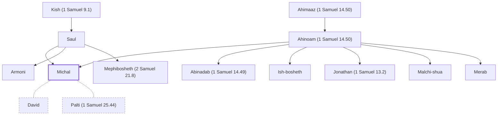

# Michal

Daughter of Saul; wife of David.

**Original-language names:** מִיכַל (H4324)

## When

- **Placed around:** [[connections/timeline/11th century BC|1060 BC]] *(Ussher: the median date of the passages naming them)*

## Family

- **Father:** [[connections/people/Saul|Saul]]
- **Mother:** [[connections/people/Ahinoam (1 Samuel 14.50)|Ahinoam (1 Samuel 14.50)]]
- **Brothers and sisters:** [[connections/people/Abinadab (1 Samuel 14.49)|Abinadab (1 Samuel 14.49)]], [[connections/people/Armoni|Armoni]], [[connections/people/Ish-bosheth|Ish-bosheth]], [[connections/people/Jonathan (1 Samuel 13.2)|Jonathan (1 Samuel 13.2)]], [[connections/people/Malchi-shua|Malchi-shua]], [[connections/people/Mephibosheth (2 Samuel 21.8)|Mephibosheth (2 Samuel 21.8)]], [[connections/people/Merab|Merab]]
- **Spouses:** [[connections/people/David|David]], [[connections/people/Palti (1 Samuel 25.44)|Palti (1 Samuel 25.44)]]
- **Tribe or nation:** Tribe of Benjamin

**Line of descent** (7 generations, father to son): [[connections/people/Aphiah|Aphiah]] → [[connections/people/Becorath|Becorath]] → [[connections/people/Zeror|Zeror]] → [[connections/people/Abiel|Abiel]] → [[connections/people/Kish (1 Samuel 9.1)|Kish (1 Samuel 9.1)]] → [[connections/people/Saul|Saul]] → **Michal**

**Family group:** [[connections/genealogy/Family of Aphiah|Family of Aphiah]], generation 7

## Appears in

[[connections/chapters/09-1-samuel/1 Samuel 14|1 Samuel 14]] · [[connections/chapters/09-1-samuel/1 Samuel 18|1 Samuel 18 (3)]] · [[connections/chapters/09-1-samuel/1 Samuel 19|1 Samuel 19 (4)]] · [[connections/chapters/09-1-samuel/1 Samuel 25|1 Samuel 25]] · [[connections/chapters/10-2-samuel/2 Samuel 3|2 Samuel 3 (2)]] · [[connections/chapters/10-2-samuel/2 Samuel 6|2 Samuel 6 (4)]] · [[connections/chapters/13-1-chronicles/1 Chronicles 15|1 Chronicles 15]]

## Appears in the same verse as

[[connections/people/Saul|Saul (13)]] · [[connections/people/David|David (11)]] · [[connections/people/Israel|Israel (2)]] · [[connections/people/Abinadab (1 Samuel 14.49)|Abinadab (1 Samuel 14.49)]] · [[connections/people/Ish-bosheth|Ish-bosheth]] · [[connections/people/Jonathan (1 Samuel 13.2)|Jonathan (1 Samuel 13.2)]] · [[connections/people/Laish|Laish]] · [[connections/people/Malchi-shua|Malchi-shua]] · [[connections/people/Merab|Merab]] · [[connections/people/Palti (1 Samuel 25.44)|Palti (1 Samuel 25.44)]] · [[connections/places/Gallim|Gallim]]
