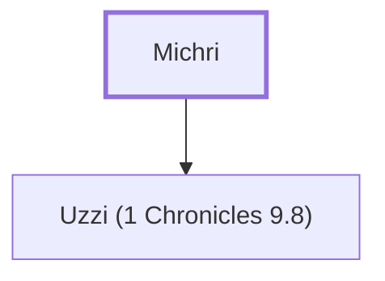

# Michri

A Benjamite who lived in Jerusalem.

**Original-language names:** מִכְרִי (H4381)

## When

- **Placed around:** [[connections/timeline/6th century BC|536 BC]] *(Ussher: the median date of the passages naming them)*

## Family

- **Children:** [[connections/people/Uzzi (1 Chronicles 9.8)|Uzzi (1 Chronicles 9.8)]]

**Family group:** [[connections/genealogy/Family of Michri|Family of Michri]], generation 1

## Appears in

[[connections/chapters/13-1-chronicles/1 Chronicles 9|1 Chronicles 9]]

## Appears in the same verse as

[[connections/people/Elah (1 Chronicles 9.8)|Elah (1 Chronicles 9.8)]] · [[connections/people/Ibneiah|Ibneiah]] · [[connections/people/Ibnijah|Ibnijah]] · [[connections/people/Jeroham (1 Chronicles 9.8)|Jeroham (1 Chronicles 9.8)]] · [[connections/people/Meshullam (1 Chronicles 9.8)|Meshullam (1 Chronicles 9.8)]] · [[connections/people/Reuel (1 Chronicles 9.8)|Reuel (1 Chronicles 9.8)]] · [[connections/people/Shephatiah (1 Chronicles 9.8)|Shephatiah (1 Chronicles 9.8)]] · [[connections/people/Uzzi (1 Chronicles 9.8)|Uzzi (1 Chronicles 9.8)]]
