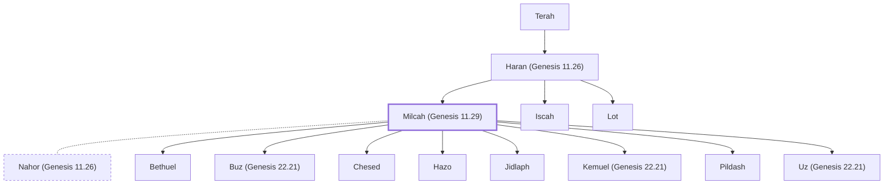

# Milcah (Genesis 11.29)

Wife of Nahor, Abraham's brother.

**Original-language names:** מִלְכָּה (H4435)

## When

- **Placed around:** [[connections/timeline/19th century BC|1857 BC]] *(Ussher: the median date of the passages naming them)*

## Family

- **Father:** [[connections/people/Haran (Genesis 11.26)|Haran (Genesis 11.26)]]
- **Brothers and sisters:** [[connections/people/Iscah|Iscah]], [[connections/people/Lot|Lot]]
- **Spouses:** [[connections/people/Nahor (Genesis 11.26)|Nahor (Genesis 11.26)]]
- **Children:** [[connections/people/Bethuel|Bethuel]], [[connections/people/Buz (Genesis 22.21)|Buz (Genesis 22.21)]], [[connections/people/Chesed|Chesed]], [[connections/people/Hazo|Hazo]], [[connections/people/Jidlaph|Jidlaph]], [[connections/people/Kemuel (Genesis 22.21)|Kemuel (Genesis 22.21)]], [[connections/people/Pildash|Pildash]], [[connections/people/Uz (Genesis 22.21)|Uz (Genesis 22.21)]]
- **Tribe or nation:** Early Patriarch

**Line of descent** (22 generations, father to son): [[connections/people/Adam|Adam]] → [[connections/people/Seth|Seth]] → [[connections/people/Enosh|Enosh]] → [[connections/people/Kenan|Kenan]] → [[connections/people/Mahalalel (Genesis 5.12)|Mahalalel (Genesis 5.12)]] → [[connections/people/Jared|Jared]] → [[connections/people/Enoch (Genesis 5.18)|Enoch (Genesis 5.18)]] → [[connections/people/Methuselah|Methuselah]] → [[connections/people/Lamech (Genesis 5.25)|Lamech (Genesis 5.25)]] → [[connections/people/Noah (Genesis 5.29)|Noah (Genesis 5.29)]] → [[connections/people/Shem|Shem]] → [[connections/people/Arpachshad|Arpachshad]] → [[connections/people/Cainan|Cainan]] → [[connections/people/Shelah (Genesis 10.24)|Shelah (Genesis 10.24)]] → [[connections/people/Eber (Genesis 10.21)|Eber (Genesis 10.21)]] → [[connections/people/Peleg|Peleg]] → [[connections/people/Reu|Reu]] → [[connections/people/Serug|Serug]] → [[connections/people/Nahor (Genesis 11.22)|Nahor (Genesis 11.22)]] → [[connections/people/Terah|Terah]] → [[connections/people/Haran (Genesis 11.26)|Haran (Genesis 11.26)]] → **Milcah (Genesis 11.29)**

**Family group:** [[connections/genealogy/Family of Adam|Family of Adam]], generation 22

## Appears in

[[connections/chapters/01-genesis/Genesis 11|Genesis 11]] · [[connections/chapters/01-genesis/Genesis 22|Genesis 22 (2)]] · [[connections/chapters/01-genesis/Genesis 24|Genesis 24 (3)]]

## Appears in the same verse as

[[connections/people/Nahor (Genesis 11.26)|Nahor (Genesis 11.26) (6)]] · [[connections/people/Abraham|Abraham (4)]] · [[connections/people/Bethuel|Bethuel (4)]] · [[connections/people/Rebekah|Rebekah (2)]] · [[connections/people/Haran (Genesis 11.26)|Haran (Genesis 11.26)]] · [[connections/people/Iscah|Iscah]] · [[connections/people/Sarah|Sarah]]
