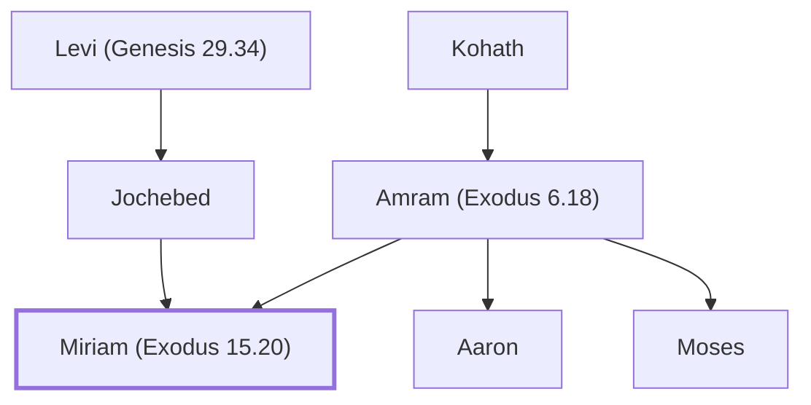

# Miriam (Exodus 15.20)

Moses' sister, a prophetess who led women in worship.

**Original-language names:** מִרְיָם (H4813)

## When

- **Lived:** ? – [[connections/timeline/15th century BC|1452 BC]] *(Jones)*
- **Placed around:** [[connections/timeline/15th century BC|1490 BC]] *(Ussher: the median date of the passages naming them)*

## Family

- **Father:** [[connections/people/Amram (Exodus 6.18)|Amram (Exodus 6.18)]]
- **Mother:** [[connections/people/Jochebed|Jochebed]]
- **Brothers and sisters:** [[connections/people/Aaron|Aaron]], [[connections/people/Moses|Moses]]
- **Tribe or nation:** Tribe of Levi

**Line of descent** (27 generations, father to son): [[connections/people/Adam|Adam]] → [[connections/people/Seth|Seth]] → [[connections/people/Enosh|Enosh]] → [[connections/people/Kenan|Kenan]] → [[connections/people/Mahalalel (Genesis 5.12)|Mahalalel (Genesis 5.12)]] → [[connections/people/Jared|Jared]] → [[connections/people/Enoch (Genesis 5.18)|Enoch (Genesis 5.18)]] → [[connections/people/Methuselah|Methuselah]] → [[connections/people/Lamech (Genesis 5.25)|Lamech (Genesis 5.25)]] → [[connections/people/Noah (Genesis 5.29)|Noah (Genesis 5.29)]] → [[connections/people/Shem|Shem]] → [[connections/people/Arpachshad|Arpachshad]] → [[connections/people/Cainan|Cainan]] → [[connections/people/Shelah (Genesis 10.24)|Shelah (Genesis 10.24)]] → [[connections/people/Eber (Genesis 10.21)|Eber (Genesis 10.21)]] → [[connections/people/Peleg|Peleg]] → [[connections/people/Reu|Reu]] → [[connections/people/Serug|Serug]] → [[connections/people/Nahor (Genesis 11.22)|Nahor (Genesis 11.22)]] → [[connections/people/Terah|Terah]] → [[connections/people/Abraham|Abraham]] → [[connections/people/Isaac|Isaac]] → [[connections/people/Israel|Israel]] → [[connections/people/Levi (Genesis 29.34)|Levi (Genesis 29.34)]] → [[connections/people/Kohath|Kohath]] → [[connections/people/Amram (Exodus 6.18)|Amram (Exodus 6.18)]] → **Miriam (Exodus 15.20)**

**Family group:** [[connections/genealogy/Family of Adam|Family of Adam]], generation 27

## Appears in

[[connections/chapters/02-exodus/Exodus 15|Exodus 15 (2)]] · [[connections/chapters/04-numbers/Numbers 12|Numbers 12 (5)]] · [[connections/chapters/04-numbers/Numbers 20|Numbers 20]] · [[connections/chapters/04-numbers/Numbers 26|Numbers 26]] · [[connections/chapters/05-deuteronomy/Deuteronomy 24|Deuteronomy 24]] · [[connections/chapters/13-1-chronicles/1 Chronicles 5|1 Chronicles 5]] · [[connections/chapters/33-micah/Micah 6|Micah 6]]

## Appears in the same verse as

[[connections/people/Aaron|Aaron (8)]] · [[connections/people/Moses|Moses (5)]] · [[connections/places/Egypt|Egypt (3)]] · [[connections/people/Amram (Exodus 6.18)|Amram (Exodus 6.18) (2)]] · [[connections/people/Abihu|Abihu]] · [[connections/people/Eleazar (Exodus 6.23)|Eleazar (Exodus 6.23)]] · [[connections/people/Israel|Israel]] · [[connections/people/Ithamar|Ithamar]] · [[connections/people/Jochebed|Jochebed]] · [[connections/people/Levi (Genesis 29.34)|Levi (Genesis 29.34)]] · [[connections/people/Nadab (Exodus 6.23)|Nadab (Exodus 6.23)]] · [[connections/places/Kadesh|Kadesh]] · [[connections/places/Zin|Zin]]
