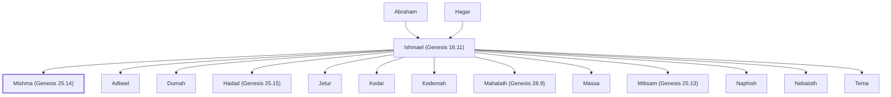

# Mishma (Genesis 25.14)

A son of Ishmael, Abraham's son.

**Original-language names:** מִשְׁמָע (H4927)

## When

- **Placed around:** [[connections/timeline/19th century BC|1821 BC]] *(Ussher: the median date of the passages naming them)*

## Family

- **Father:** [[connections/people/Ishmael (Genesis 16.11)|Ishmael (Genesis 16.11)]]
- **Brothers and sisters:** [[connections/people/Adbeel|Adbeel]], [[connections/people/Dumah|Dumah]], [[connections/people/Hadad (Genesis 25.15)|Hadad (Genesis 25.15)]], [[connections/people/Jetur|Jetur]], [[connections/people/Kedar|Kedar]], [[connections/people/Kedemah|Kedemah]], [[connections/people/Mahalath (Genesis 28.9)|Mahalath (Genesis 28.9)]], [[connections/people/Massa|Massa]], [[connections/people/Mibsam (Genesis 25.13)|Mibsam (Genesis 25.13)]], [[connections/people/Naphish|Naphish]], [[connections/people/Nebaioth|Nebaioth]], [[connections/people/Tema|Tema]]
- **Tribe or nation:** Arabia

**Line of descent** (23 generations, father to son): [[connections/people/Adam|Adam]] → [[connections/people/Seth|Seth]] → [[connections/people/Enosh|Enosh]] → [[connections/people/Kenan|Kenan]] → [[connections/people/Mahalalel (Genesis 5.12)|Mahalalel (Genesis 5.12)]] → [[connections/people/Jared|Jared]] → [[connections/people/Enoch (Genesis 5.18)|Enoch (Genesis 5.18)]] → [[connections/people/Methuselah|Methuselah]] → [[connections/people/Lamech (Genesis 5.25)|Lamech (Genesis 5.25)]] → [[connections/people/Noah (Genesis 5.29)|Noah (Genesis 5.29)]] → [[connections/people/Shem|Shem]] → [[connections/people/Arpachshad|Arpachshad]] → [[connections/people/Cainan|Cainan]] → [[connections/people/Shelah (Genesis 10.24)|Shelah (Genesis 10.24)]] → [[connections/people/Eber (Genesis 10.21)|Eber (Genesis 10.21)]] → [[connections/people/Peleg|Peleg]] → [[connections/people/Reu|Reu]] → [[connections/people/Serug|Serug]] → [[connections/people/Nahor (Genesis 11.22)|Nahor (Genesis 11.22)]] → [[connections/people/Terah|Terah]] → [[connections/people/Abraham|Abraham]] → [[connections/people/Ishmael (Genesis 16.11)|Ishmael (Genesis 16.11)]] → **Mishma (Genesis 25.14)**

**Family group:** [[connections/genealogy/Family of Adam|Family of Adam]], generation 23

## Appears in

[[connections/chapters/01-genesis/Genesis 25|Genesis 25]] · [[connections/chapters/13-1-chronicles/1 Chronicles 1|1 Chronicles 1]]

## Appears in the same verse as

[[connections/people/Dumah|Dumah (2)]] · [[connections/people/Massa|Massa (2)]] · [[connections/people/Hadad (Genesis 25.15)|Hadad (Genesis 25.15)]] · [[connections/people/Tema|Tema]]
