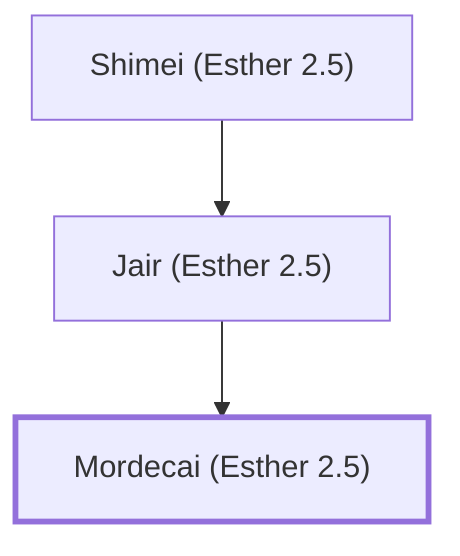

# Mordecai (Esther 2.5)

Esther's cousin, a Jewish leader in the Persian court.

**Original-language names:** מׇרְדֳּכַי (H4782)

## When

- **Placed around:** [[connections/timeline/5th century BC|453 BC]] *(Ussher: the median date of the passages naming them)*

## Family

- **Father:** [[connections/people/Jair (Esther 2.5)|Jair (Esther 2.5)]]
- **Tribe or nation:** Tribe of Judah

**Line of descent** (4 generations, father to son): [[connections/people/Kish (Esther 2.5)|Kish (Esther 2.5)]] → [[connections/people/Shimei (Esther 2.5)|Shimei (Esther 2.5)]] → [[connections/people/Jair (Esther 2.5)|Jair (Esther 2.5)]] → **Mordecai (Esther 2.5)**

**Family group:** [[connections/genealogy/Family of Kish (Esther 2.5)|Family of Kish (Esther 2.5)]], generation 4

## Appears in

[[connections/chapters/17-esther/Esther 2|Esther 2 (9)]] · [[connections/chapters/17-esther/Esther 3|Esther 3 (5)]] · [[connections/chapters/17-esther/Esther 4|Esther 4 (11)]] · [[connections/chapters/17-esther/Esther 5|Esther 5 (3)]] · [[connections/chapters/17-esther/Esther 6|Esther 6 (7)]] · [[connections/chapters/17-esther/Esther 7|Esther 7 (2)]] · [[connections/chapters/17-esther/Esther 8|Esther 8 (5)]] · [[connections/chapters/17-esther/Esther 9|Esther 9 (6)]] · [[connections/chapters/17-esther/Esther 10|Esther 10 (2)]]

## Appears in the same verse as

[[connections/people/Esther|Esther (19)]] · [[connections/people/Haman|Haman (17)]] · [[connections/people/Ahasuerus|Ahasuerus (7)]] · [[connections/people/Hathach|Hathach (4)]] · [[connections/people/Abihail (Esther 2.15)|Abihail (Esther 2.15) (2)]] · [[connections/people/Bigthan|Bigthan (2)]] · [[connections/people/Teresh|Teresh (2)]] · [[connections/people/Zeresh|Zeresh (2)]] · [[connections/places/Susa|Susa (2)]] · [[connections/people/Harbona|Harbona]] · [[connections/people/Hegai|Hegai]] · [[connections/people/Jair (Esther 2.5)|Jair (Esther 2.5)]] · [[connections/people/Kish (Esther 2.5)|Kish (Esther 2.5)]] · [[connections/people/Shimei (Esther 2.5)|Shimei (Esther 2.5)]] · [[connections/places/Cush|Cush]] · [[connections/places/India|India]] · [[connections/places/Media|Media]] · [[connections/places/Persia|Persia]]
