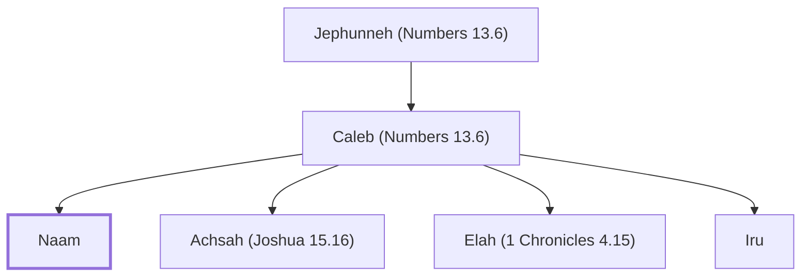

# Naam

Son of Caleb, from the tribe of Judah.

**Original-language names:** נָ֑עַם (H5277)

## When

- **Placed around:** [[connections/timeline/18th century BC|1721 BC]] *(Ussher: the median date of the passages naming them)*

## Family

- **Father:** [[connections/people/Caleb (Numbers 13.6)|Caleb (Numbers 13.6)]]
- **Brothers and sisters:** [[connections/people/Achsah (Joshua 15.16)|Achsah (Joshua 15.16)]], [[connections/people/Elah (1 Chronicles 4.15)|Elah (1 Chronicles 4.15)]], [[connections/people/Iru|Iru]]
- **Tribe or nation:** Tribe of Judah

**Line of descent** (3 generations, father to son): [[connections/people/Jephunneh (Numbers 13.6)|Jephunneh (Numbers 13.6)]] → [[connections/people/Caleb (Numbers 13.6)|Caleb (Numbers 13.6)]] → **Naam**

**Family group:** [[connections/genealogy/Family of Jephunneh (Numbers 13.6)|Family of Jephunneh (Numbers 13.6)]], generation 3

## Appears in

[[connections/chapters/13-1-chronicles/1 Chronicles 4|1 Chronicles 4]]

## Appears in the same verse as

[[connections/people/Caleb (Numbers 13.6)|Caleb (Numbers 13.6)]] · [[connections/people/Elah (1 Chronicles 4.15)|Elah (1 Chronicles 4.15)]] · [[connections/people/Iru|Iru]] · [[connections/people/Jephunneh (Numbers 13.6)|Jephunneh (Numbers 13.6)]] · [[connections/people/Kenaz (1 Chronicles 4.15)|Kenaz (1 Chronicles 4.15)]]
