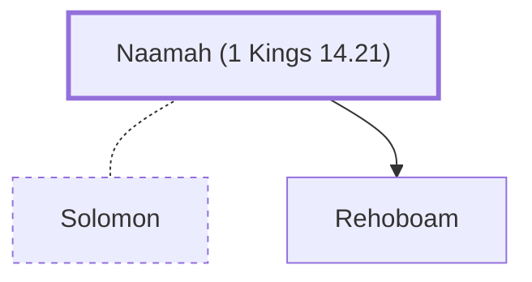

# Naamah (1 Kings 14.21)

An Ammonite; mother of King Rehoboam of Judah.

**Original-language names:** נַעֲמָה (H5279a)

## When

- **Placed around:** [[connections/timeline/10th century BC|975 BC]] *(Ussher: the median date of the passages naming them)*

## Family

- **Spouses:** [[connections/people/Solomon|Solomon]]
- **Children:** [[connections/people/Rehoboam|Rehoboam]]
- **Tribe or nation:** Ammon

**Family group:** [[connections/genealogy/Family of Adam|Family of Adam]], generation 37

## Appears in

[[connections/chapters/11-1-kings/1 Kings 14|1 Kings 14 (2)]] · [[connections/chapters/14-2-chronicles/2 Chronicles 12|2 Chronicles 12]]

## Appears in the same verse as

[[connections/people/Rehoboam|Rehoboam (3)]] · [[connections/people/Israel|Israel (2)]] · [[connections/places/Jerusalem|Jerusalem (2)]] · [[connections/people/Abijah (1 Kings 14.31)|Abijah (1 Kings 14.31)]] · [[connections/people/David|David]] · [[connections/people/Judah (Genesis 29.35)|Judah (Genesis 29.35)]] · [[connections/people/Solomon|Solomon]]
