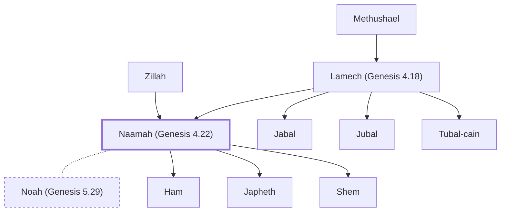

# Naamah (Genesis 4.22)

Daughter of Lamech and Zillah, sister of Tubal-cain.

**Original-language names:** נַעֲמָה (H5279a)

## When

- **Placed around:** [[connections/timeline/41st century BC|4003 BC]] *(Ussher: the median date of the passages naming them)*

## Family

- **Father:** [[connections/people/Lamech (Genesis 4.18)|Lamech (Genesis 4.18)]]
- **Mother:** [[connections/people/Zillah|Zillah]]
- **Brothers and sisters:** [[connections/people/Jabal|Jabal]], [[connections/people/Jubal|Jubal]], [[connections/people/Tubal-cain|Tubal-cain]]
- **Spouses:** [[connections/people/Noah (Genesis 5.29)|Noah (Genesis 5.29) (uncertain)]]
- **Children:** [[connections/people/Ham|Ham (uncertain)]], [[connections/people/Japheth|Japheth (uncertain)]], [[connections/people/Shem|Shem (uncertain)]]
- **Tribe or nation:** Early Patriarch

**Line of descent** (8 generations, father to son): [[connections/people/Adam|Adam]] → [[connections/people/Cain|Cain]] → [[connections/people/Enoch (Genesis 4.17)|Enoch (Genesis 4.17)]] → [[connections/people/Irad|Irad]] → [[connections/people/Mehujael|Mehujael]] → [[connections/people/Methushael|Methushael]] → [[connections/people/Lamech (Genesis 4.18)|Lamech (Genesis 4.18)]] → **Naamah (Genesis 4.22)**

**Family group:** [[connections/genealogy/Family of Adam|Family of Adam]], generation 8

## Appears in

[[connections/chapters/01-genesis/Genesis 4|Genesis 4]]

## Appears in the same verse as

[[connections/people/Tubal-cain|Tubal-cain]] · [[connections/people/Zillah|Zillah]]
