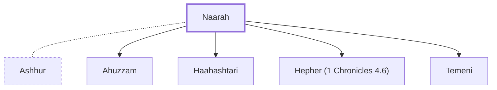

# Naarah

Wife of Ashhur, the founder of Tekoa.

**Original-language names:** נַעֲרָה (H5292b)

## When

- **Placed around:** [[connections/timeline/18th century BC|1721 BC]] *(Ussher: the median date of the passages naming them)*

## Family

- **Spouses:** [[connections/people/Ashhur|Ashhur]]
- **Children:** [[connections/people/Ahuzzam|Ahuzzam]], [[connections/people/Haahashtari|Haahashtari]], [[connections/people/Hepher (1 Chronicles 4.6)|Hepher (1 Chronicles 4.6)]], [[connections/people/Temeni|Temeni]]
- **Tribe or nation:** Tribe of Judah(?)

**Family group:** [[connections/genealogy/Family of Adam|Family of Adam]], generation 29

## Appears in

[[connections/chapters/13-1-chronicles/1 Chronicles 4|1 Chronicles 4 (2)]]

## Appears in the same verse as

[[connections/people/Ahuzzam|Ahuzzam]] · [[connections/people/Ashhur|Ashhur]] · [[connections/people/Haahashtari|Haahashtari]] · [[connections/people/Helah|Helah]] · [[connections/people/Hepher (1 Chronicles 4.6)|Hepher (1 Chronicles 4.6)]] · [[connections/people/Temeni|Temeni]] · [[connections/places/Tekoa|Tekoa]]
