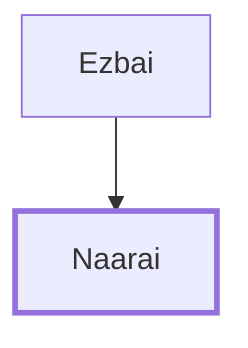

# Naarai

One of David's mighty warriors, son of Ezbai.

**Original-language names:** נַעֲרַי (H5293)

## When

- **Placed around:** [[connections/timeline/11th century BC|1055 BC]] *(Ussher: the median date of the passages naming them)*

## Family

- **Father:** [[connections/people/Ezbai|Ezbai]]

**Family group:** [[connections/genealogy/Family of Ezbai|Family of Ezbai]], generation 2

## Appears in

[[connections/chapters/13-1-chronicles/1 Chronicles 11|1 Chronicles 11]]

## Appears in the same verse as

[[connections/people/Ezbai|Ezbai]] · [[connections/people/Hezro|Hezro]]
