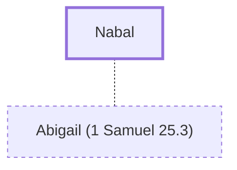

# Nabal

Wealthy Carmelite; husband of Abigail. He was known for foolishness.

**Original-language names:** נָבָל (H5037)

## When

- **Placed around:** [[connections/timeline/11th century BC|1060 BC]] *(Ussher: the median date of the passages naming them)*

## Family

- **Spouses:** [[connections/people/Abigail (1 Samuel 25.3)|Abigail (1 Samuel 25.3)]]

## Appears in

[[connections/chapters/09-1-samuel/1 Samuel 25|1 Samuel 25 (14)]] · [[connections/chapters/09-1-samuel/1 Samuel 27|1 Samuel 27]] · [[connections/chapters/09-1-samuel/1 Samuel 30|1 Samuel 30]] · [[connections/chapters/10-2-samuel/2 Samuel 2|2 Samuel 2]] · [[connections/chapters/10-2-samuel/2 Samuel 3|2 Samuel 3]]

## Appears in the same verse as

[[connections/people/David|David (9)]] · [[connections/people/Abigail (1 Samuel 25.3)|Abigail (1 Samuel 25.3) (8)]] · [[connections/people/Ahinoam (1 Samuel 25.43)|Ahinoam (1 Samuel 25.43) (3)]] · [[connections/places/Jezreel (Joshua 15.56)|Jezreel (Joshua 15.56) (3)]] · [[connections/people/Absalom|Absalom]] · [[connections/people/Achish|Achish]] · [[connections/people/Chileab|Chileab]] · [[connections/people/Israel|Israel]] · [[connections/people/Jesse|Jesse]] · [[connections/people/Maacah (2 Samuel 3.3)|Maacah (2 Samuel 3.3)]] · [[connections/people/Talmai (2 Samuel 3.3)|Talmai (2 Samuel 3.3)]] · [[connections/places/Carmel|Carmel]] · [[connections/places/Gath|Gath]] · [[connections/places/Geshur|Geshur]]
