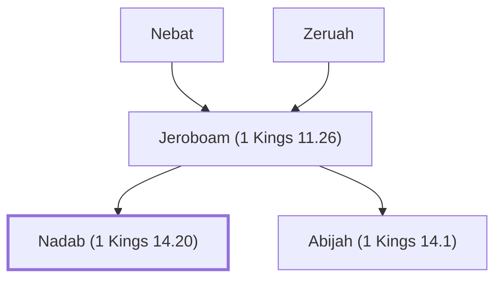

# Nadab (1 Kings 14.20)

King of Israel, son of Jeroboam I, reigned briefly.

**Original-language names:** נָדָב (H5070)

## When

- **Placed around:** [[connections/timeline/10th century BC|954 BC]] *(Ussher: the median date of the passages naming them)*

## Family

- **Father:** [[connections/people/Jeroboam (1 Kings 11.26)|Jeroboam (1 Kings 11.26)]]
- **Brothers and sisters:** [[connections/people/Abijah (1 Kings 14.1)|Abijah (1 Kings 14.1)]]
- **Tribe or nation:** Israel

**Line of descent** (3 generations, father to son): [[connections/people/Nebat|Nebat]] → [[connections/people/Jeroboam (1 Kings 11.26)|Jeroboam (1 Kings 11.26)]] → **Nadab (1 Kings 14.20)**

**Family group:** [[connections/genealogy/Family of Nebat|Family of Nebat]], generation 3

## Events

- [[connections/timeline/10th century BC|954 BC]] · [[connections/events/Reign of Nadab|Reign of Nadab]]

## Appears in

[[connections/chapters/11-1-kings/1 Kings 14|1 Kings 14]] · [[connections/chapters/11-1-kings/1 Kings 15|1 Kings 15 (3)]]

## Appears in the same verse as

[[connections/people/Israel|Israel (3)]] · [[connections/people/Jeroboam (1 Kings 11.26)|Jeroboam (1 Kings 11.26) (2)]] · [[connections/people/Ahijah (1 Kings 15.27)|Ahijah (1 Kings 15.27)]] · [[connections/people/Asa (1 Kings 15.8)|Asa (1 Kings 15.8)]] · [[connections/people/Baasha|Baasha]] · [[connections/people/Issachar (Genesis 30.18)|Issachar (Genesis 30.18)]] · [[connections/people/Judah (Genesis 29.35)|Judah (Genesis 29.35)]] · [[connections/places/Gibbethon|Gibbethon]]
