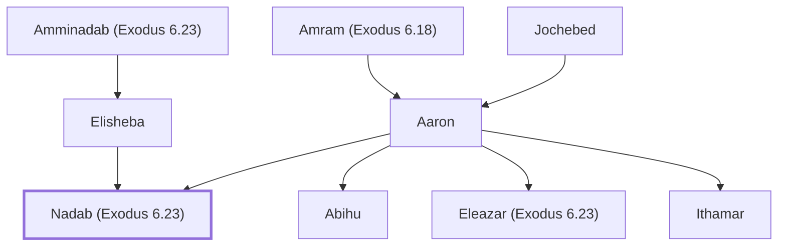

# Nadab (Exodus 6.23)

Son of Aaron, consumed by fire for offering incense.

**Original-language names:** נָדָב (H5070)

## When

- **Placed around:** [[connections/timeline/15th century BC|1490 BC]] *(Ussher: the median date of the passages naming them)*

## Family

- **Father:** [[connections/people/Aaron|Aaron]]
- **Mother:** [[connections/people/Elisheba|Elisheba]]
- **Brothers and sisters:** [[connections/people/Abihu|Abihu]], [[connections/people/Eleazar (Exodus 6.23)|Eleazar (Exodus 6.23)]], [[connections/people/Ithamar|Ithamar]]
- **Tribe or nation:** Tribe of Levi

**Line of descent** (28 generations, father to son): [[connections/people/Adam|Adam]] → [[connections/people/Seth|Seth]] → [[connections/people/Enosh|Enosh]] → [[connections/people/Kenan|Kenan]] → [[connections/people/Mahalalel (Genesis 5.12)|Mahalalel (Genesis 5.12)]] → [[connections/people/Jared|Jared]] → [[connections/people/Enoch (Genesis 5.18)|Enoch (Genesis 5.18)]] → [[connections/people/Methuselah|Methuselah]] → [[connections/people/Lamech (Genesis 5.25)|Lamech (Genesis 5.25)]] → [[connections/people/Noah (Genesis 5.29)|Noah (Genesis 5.29)]] → [[connections/people/Shem|Shem]] → [[connections/people/Arpachshad|Arpachshad]] → [[connections/people/Cainan|Cainan]] → [[connections/people/Shelah (Genesis 10.24)|Shelah (Genesis 10.24)]] → [[connections/people/Eber (Genesis 10.21)|Eber (Genesis 10.21)]] → [[connections/people/Peleg|Peleg]] → [[connections/people/Reu|Reu]] → [[connections/people/Serug|Serug]] → [[connections/people/Nahor (Genesis 11.22)|Nahor (Genesis 11.22)]] → [[connections/people/Terah|Terah]] → [[connections/people/Abraham|Abraham]] → [[connections/people/Isaac|Isaac]] → [[connections/people/Israel|Israel]] → [[connections/people/Levi (Genesis 29.34)|Levi (Genesis 29.34)]] → [[connections/people/Kohath|Kohath]] → [[connections/people/Amram (Exodus 6.18)|Amram (Exodus 6.18)]] → [[connections/people/Aaron|Aaron]] → **Nadab (Exodus 6.23)**

**Family group:** [[connections/genealogy/Family of Adam|Family of Adam]], generation 28

## Appears in

[[connections/chapters/02-exodus/Exodus 6|Exodus 6]] · [[connections/chapters/02-exodus/Exodus 24|Exodus 24 (2)]] · [[connections/chapters/02-exodus/Exodus 28|Exodus 28]] · [[connections/chapters/03-leviticus/Leviticus 10|Leviticus 10]] · [[connections/chapters/04-numbers/Numbers 3|Numbers 3 (2)]] · [[connections/chapters/04-numbers/Numbers 26|Numbers 26 (2)]] · [[connections/chapters/13-1-chronicles/1 Chronicles 5|1 Chronicles 5]] · [[connections/chapters/13-1-chronicles/1 Chronicles 24|1 Chronicles 24 (2)]]

## Appears in the same verse as

[[connections/people/Abihu|Abihu (12)]] · [[connections/people/Aaron|Aaron (10)]] · [[connections/people/Eleazar (Exodus 6.23)|Eleazar (Exodus 6.23) (8)]] · [[connections/people/Ithamar|Ithamar (8)]] · [[connections/people/Israel|Israel (3)]] · [[connections/people/Moses|Moses (3)]] · [[connections/people/Amminadab (Exodus 6.23)|Amminadab (Exodus 6.23)]] · [[connections/people/Amram (Exodus 6.18)|Amram (Exodus 6.18)]] · [[connections/people/Elisheba|Elisheba]] · [[connections/people/Miriam (Exodus 15.20)|Miriam (Exodus 15.20)]] · [[connections/people/Nahshon|Nahshon]] · [[connections/places/Sinai Wilderness|Sinai Wilderness]]
