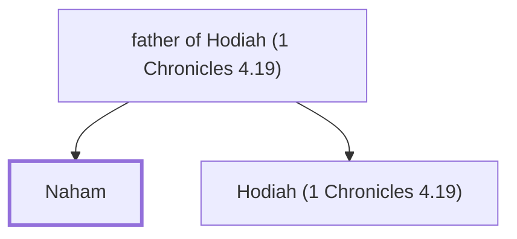

# Naham

Brother of Hodiah who married Ishbar.

**Original-language names:** נַ֫חַם (H5163)

## When

- **Placed around:** [[connections/timeline/18th century BC|1721 BC]] *(Ussher: the median date of the passages naming them)*

## Family

- **Father:** [[connections/people/father of Hodiah (1 Chronicles 4.19)|father of Hodiah (1 Chronicles 4.19)]]
- **Brothers and sisters:** [[connections/people/Hodiah (1 Chronicles 4.19)|Hodiah (1 Chronicles 4.19)]]
- **Tribe or nation:** Tribe of Judah(?)

**Family group:** [[connections/genealogy/Family of father of Hodiah (1 Chronicles 4.19)|Family of father of Hodiah (1 Chronicles 4.19)]], generation 2

## Appears in

[[connections/chapters/13-1-chronicles/1 Chronicles 4|1 Chronicles 4]]

## Appears in the same verse as

[[connections/people/Hodiah (1 Chronicles 4.19)|Hodiah (1 Chronicles 4.19)]] · [[connections/places/Eshtemoa|Eshtemoa]] · [[connections/places/Keilah|Keilah]]
