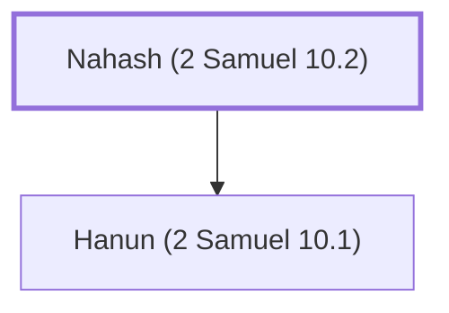

# Nahash (2 Samuel 10.2)

Ammonite king, father of Hanun, showed kindness to David.

**Original-language names:** נָחָשׁ (H5176)

## When

- **Placed around:** [[connections/timeline/11th century BC|1037 BC]] *(Ussher: the median date of the passages naming them)*

## Family

- **Children:** [[connections/people/Hanun (2 Samuel 10.1)|Hanun (2 Samuel 10.1)]]
- **Tribe or nation:** Ammon

**Family group:** [[connections/genealogy/Family of Nahash (2 Samuel 10.2)|Family of Nahash (2 Samuel 10.2)]], generation 1

## Appears in

[[connections/chapters/10-2-samuel/2 Samuel 10|2 Samuel 10]] · [[connections/chapters/13-1-chronicles/1 Chronicles 19|1 Chronicles 19 (2)]]

## Appears in the same verse as

[[connections/places/Ammon|Ammon (3)]] · [[connections/people/David|David (2)]] · [[connections/people/Hanun (2 Samuel 10.1)|Hanun (2 Samuel 10.1) (2)]]
