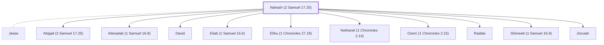

# Nahash (2 Samuel 17.25)

Mother of Abigail and Zeruiah, David's sisters.

**Original-language names:** נָחָשׁ (H5176)

## When

- **Placed around:** [[connections/timeline/11th century BC|1023 BC]] *(Ussher: the median date of the passages naming them)*

## Family

- **Spouses:** [[connections/people/Jesse|Jesse]]
- **Children:** [[connections/people/Abigail (2 Samuel 17.25)|Abigail (2 Samuel 17.25) (uncertain)]], [[connections/people/Abinadab (1 Samuel 16.8)|Abinadab (1 Samuel 16.8)]], [[connections/people/David|David]], [[connections/people/Eliab (1 Samuel 16.6)|Eliab (1 Samuel 16.6)]], [[connections/people/Elihu (1 Chronicles 27.18)|Elihu (1 Chronicles 27.18)]], [[connections/people/Nethanel (1 Chronicles 2.14)|Nethanel (1 Chronicles 2.14)]], [[connections/people/Ozem (1 Chronicles 2.15)|Ozem (1 Chronicles 2.15)]], [[connections/people/Raddai|Raddai]], [[connections/people/Shimeah (1 Samuel 16.9)|Shimeah (1 Samuel 16.9)]], [[connections/people/Zeruiah|Zeruiah]]

**Family group:** [[connections/genealogy/Family of Adam|Family of Adam]], generation 35

## Appears in

[[connections/chapters/10-2-samuel/2 Samuel 17|2 Samuel 17]]

## Appears in the same verse as

[[connections/people/Abigail (2 Samuel 17.25)|Abigail (2 Samuel 17.25)]] · [[connections/people/Absalom|Absalom]] · [[connections/people/Amasa (2 Samuel 17.25)|Amasa (2 Samuel 17.25)]] · [[connections/people/Jether (2 Samuel 17.25)|Jether (2 Samuel 17.25)]] · [[connections/people/Joab (1 Samuel 26.6)|Joab (1 Samuel 26.6)]] · [[connections/people/Zeruiah|Zeruiah]]
