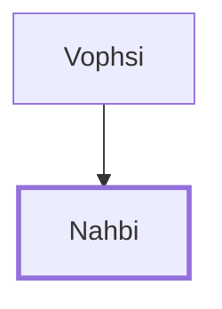

# Nahbi

The spy from the tribe of Naphtali.

**Original-language names:** נַחְבִּי (H5147)

## When

- **Placed around:** [[connections/timeline/15th century BC|1490 BC]] *(Ussher: the median date of the passages naming them)*

## Family

- **Father:** [[connections/people/Vophsi|Vophsi]]

**Family group:** [[connections/genealogy/Family of Vophsi|Family of Vophsi]], generation 2

## Appears in

[[connections/chapters/04-numbers/Numbers 13|Numbers 13]]

## Appears in the same verse as

[[connections/people/Naphtali|Naphtali]] · [[connections/people/Vophsi|Vophsi]]
