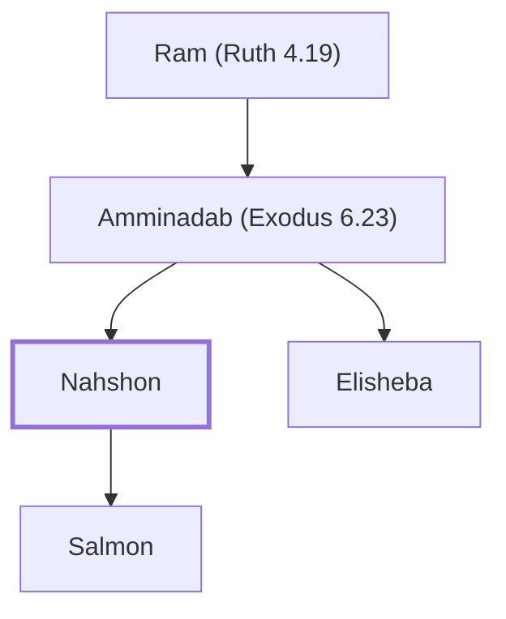

# Nahshon

Son of Amminadab, leader of Judah, ancestor of David.

**Original-language names:** נַחְשׁוֹן (H5177) · Ναασσών (G3476)

## When

- **Placed around:** [[connections/timeline/15th century BC|1490 BC]] *(Ussher: the median date of the passages naming them)*

## Family

- **Father:** [[connections/people/Amminadab (Exodus 6.23)|Amminadab (Exodus 6.23)]]
- **Brothers and sisters:** [[connections/people/Elisheba|Elisheba]]
- **Children:** [[connections/people/Salmon|Salmon]]
- **Tribe or nation:** Tribe of Judah

**Line of descent** (29 generations, father to son): [[connections/people/Adam|Adam]] → [[connections/people/Seth|Seth]] → [[connections/people/Enosh|Enosh]] → [[connections/people/Kenan|Kenan]] → [[connections/people/Mahalalel (Genesis 5.12)|Mahalalel (Genesis 5.12)]] → [[connections/people/Jared|Jared]] → [[connections/people/Enoch (Genesis 5.18)|Enoch (Genesis 5.18)]] → [[connections/people/Methuselah|Methuselah]] → [[connections/people/Lamech (Genesis 5.25)|Lamech (Genesis 5.25)]] → [[connections/people/Noah (Genesis 5.29)|Noah (Genesis 5.29)]] → [[connections/people/Shem|Shem]] → [[connections/people/Arpachshad|Arpachshad]] → [[connections/people/Cainan|Cainan]] → [[connections/people/Shelah (Genesis 10.24)|Shelah (Genesis 10.24)]] → [[connections/people/Eber (Genesis 10.21)|Eber (Genesis 10.21)]] → [[connections/people/Peleg|Peleg]] → [[connections/people/Reu|Reu]] → [[connections/people/Serug|Serug]] → [[connections/people/Nahor (Genesis 11.22)|Nahor (Genesis 11.22)]] → [[connections/people/Terah|Terah]] → [[connections/people/Abraham|Abraham]] → [[connections/people/Isaac|Isaac]] → [[connections/people/Israel|Israel]] → [[connections/people/Judah (Genesis 29.35)|Judah (Genesis 29.35)]] → [[connections/people/Perez|Perez]] → [[connections/people/Hezron (Genesis 46.12)|Hezron (Genesis 46.12)]] → [[connections/people/Ram (Ruth 4.19)|Ram (Ruth 4.19)]] → [[connections/people/Amminadab (Exodus 6.23)|Amminadab (Exodus 6.23)]] → **Nahshon**

**Family group:** [[connections/genealogy/Family of Adam|Family of Adam]], generation 29

## Appears in

[[connections/chapters/02-exodus/Exodus 6|Exodus 6]] · [[connections/chapters/04-numbers/Numbers 1|Numbers 1]] · [[connections/chapters/04-numbers/Numbers 2|Numbers 2]] · [[connections/chapters/04-numbers/Numbers 7|Numbers 7 (2)]] · [[connections/chapters/04-numbers/Numbers 10|Numbers 10]] · [[connections/chapters/08-ruth/Ruth 4|Ruth 4]] · [[connections/chapters/13-1-chronicles/1 Chronicles 2|1 Chronicles 2 (2)]] · [[connections/chapters/40-matthew/Matthew 1|Matthew 1]] · [[connections/chapters/42-luke/Luke 3|Luke 3]]

## Appears in the same verse as

[[connections/people/Amminadab (Exodus 6.23)|Amminadab (Exodus 6.23) (9)]] · [[connections/people/Judah (Genesis 29.35)|Judah (Genesis 29.35) (5)]] · [[connections/people/Salmon|Salmon (4)]] · [[connections/people/Boaz|Boaz (2)]] · [[connections/people/Ram (Ruth 4.19)|Ram (Ruth 4.19) (2)]] · [[connections/people/Aaron|Aaron]] · [[connections/people/Abihu|Abihu]] · [[connections/people/Eleazar (Exodus 6.23)|Eleazar (Exodus 6.23)]] · [[connections/people/Elisheba|Elisheba]] · [[connections/people/Ithamar|Ithamar]] · [[connections/people/Jesse|Jesse]] · [[connections/people/Nadab (Exodus 6.23)|Nadab (Exodus 6.23)]] · [[connections/people/Obed (Ruth 4.17)|Obed (Ruth 4.17)]]
