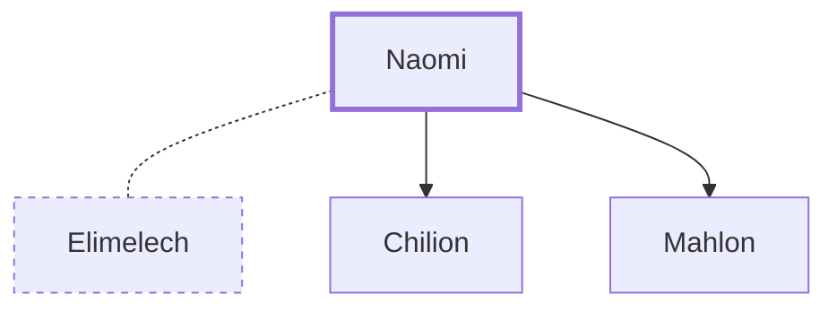

# Naomi

Israelite woman, mother-in-law of Ruth.

**Also called:** Mara

**Original-language names:** נׇעֳמִי (H5281) · מָרָא (H4755)

## When

- **Placed around:** [[connections/timeline/14th century BC|1307 BC]] *(Ussher: the median date of the passages naming them)*

## Family

- **Spouses:** [[connections/people/Elimelech|Elimelech]]
- **Children:** [[connections/people/Chilion|Chilion]], [[connections/people/Mahlon|Mahlon]]

**Family group:** [[connections/genealogy/Family of Adam|Family of Adam]], generation 32

## Appears in

[[connections/chapters/08-ruth/Ruth 1|Ruth 1 (8)]] · [[connections/chapters/08-ruth/Ruth 2|Ruth 2 (5)]] · [[connections/chapters/08-ruth/Ruth 3|Ruth 3]] · [[connections/chapters/08-ruth/Ruth 4|Ruth 4 (6)]]

## Appears in the same verse as

[[connections/places/Moab|Moab (6)]] · [[connections/people/Elimelech|Elimelech (5)]] · [[connections/people/Ruth|Ruth (4)]] · [[connections/people/Boaz|Boaz (3)]] · [[connections/places/Bethlehem (Genesis 35.16)|Bethlehem (Genesis 35.16) (3)]] · [[connections/people/Chilion|Chilion (2)]] · [[connections/people/Mahlon|Mahlon (2)]] · [[connections/people/David|David]] · [[connections/people/Israel|Israel]] · [[connections/people/Jesse|Jesse]] · [[connections/people/Judah (Genesis 29.35)|Judah (Genesis 29.35)]] · [[connections/people/Obed (Ruth 4.17)|Obed (Ruth 4.17)]]
