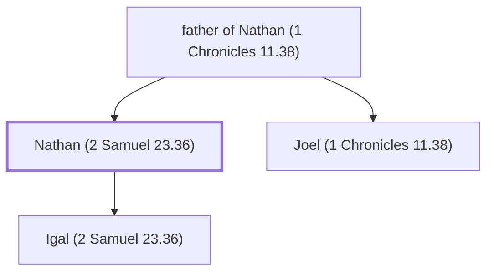

# Nathan (2 Samuel 23.36)

One of David's mighty men, brother of Joel.

**Original-language names:** נָתָן (H5416)

## When

- **Placed around:** [[connections/timeline/11th century BC|1055 BC]] *(Ussher: the median date of the passages naming them)*

## Family

- **Father:** [[connections/people/father of Nathan (1 Chronicles 11.38)|father of Nathan (1 Chronicles 11.38)]]
- **Brothers and sisters:** [[connections/people/Joel (1 Chronicles 11.38)|Joel (1 Chronicles 11.38)]]
- **Children:** [[connections/people/Igal (2 Samuel 23.36)|Igal (2 Samuel 23.36)]]

**Family group:** [[connections/genealogy/Family of father of Nathan (1 Chronicles 11.38)|Family of father of Nathan (1 Chronicles 11.38)]], generation 2

## Appears in

[[connections/chapters/10-2-samuel/2 Samuel 23|2 Samuel 23]] · [[connections/chapters/13-1-chronicles/1 Chronicles 11|1 Chronicles 11]]

## Appears in the same verse as

[[connections/people/Bani (2 Samuel 23.36)|Bani (2 Samuel 23.36)]] · [[connections/people/Hagri|Hagri]] · [[connections/people/Igal (2 Samuel 23.36)|Igal (2 Samuel 23.36)]] · [[connections/people/Joel (1 Chronicles 11.38)|Joel (1 Chronicles 11.38)]] · [[connections/people/Mibhar|Mibhar]] · [[connections/places/Zobah|Zobah]]
