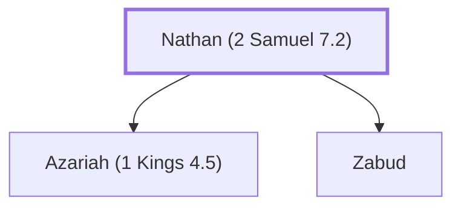

# Nathan (2 Samuel 7.2)

Prophet during the reigns of David and Solomon.

**Original-language names:** נָתָן (H5416)

## When

- **Placed around:** [[connections/timeline/11th century BC|1015 BC]] *(Ussher: the median date of the passages naming them)*

## Family

- **Children:** [[connections/people/Azariah (1 Kings 4.5)|Azariah (1 Kings 4.5)]], [[connections/people/Zabud|Zabud]]

**Family group:** [[connections/genealogy/Family of Nathan (2 Samuel 7.2)|Family of Nathan (2 Samuel 7.2)]], generation 1

## Appears in

[[connections/chapters/10-2-samuel/2 Samuel 7|2 Samuel 7 (4)]] · [[connections/chapters/10-2-samuel/2 Samuel 12|2 Samuel 12 (6)]] · [[connections/chapters/11-1-kings/1 Kings 1|1 Kings 1 (11)]] · [[connections/chapters/11-1-kings/1 Kings 4|1 Kings 4]] · [[connections/chapters/13-1-chronicles/1 Chronicles 17|1 Chronicles 17 (4)]] · [[connections/chapters/13-1-chronicles/1 Chronicles 29|1 Chronicles 29]] · [[connections/chapters/14-2-chronicles/2 Chronicles 9|2 Chronicles 9]] · [[connections/chapters/14-2-chronicles/2 Chronicles 29|2 Chronicles 29]] · [[connections/chapters/19-psalms/Psalms 51|Psalms 51]]

## Appears in the same verse as

[[connections/people/David|David (16)]] · [[connections/people/Solomon|Solomon (6)]] · [[connections/people/Zadok (2 Samuel 8.17)|Zadok (2 Samuel 8.17) (6)]] · [[connections/people/Benaiah (2 Samuel 8.18)|Benaiah (2 Samuel 8.18) (5)]] · [[connections/people/Jehoiada (2 Samuel 8.18)|Jehoiada (2 Samuel 8.18) (4)]] · [[connections/people/Adonijah (2 Samuel 3.4)|Adonijah (2 Samuel 3.4) (3)]] · [[connections/people/Bathsheba|Bathsheba (2)]] · [[connections/people/Gad (1 Samuel 22.5)|Gad (1 Samuel 22.5) (2)]] · [[connections/people/Israel|Israel (2)]] · [[connections/places/Gihon|Gihon (2)]] · [[connections/people/Ahijah (1 Kings 11.29)|Ahijah (1 Kings 11.29)]] · [[connections/people/Azariah (1 Kings 4.5)|Azariah (1 Kings 4.5)]] · [[connections/people/Haggith|Haggith]] · [[connections/people/Iddo (2 Chronicles 9.29)|Iddo (2 Chronicles 9.29)]] · [[connections/people/Jeroboam (1 Kings 11.26)|Jeroboam (1 Kings 11.26)]] · [[connections/people/Nebat|Nebat]] · [[connections/people/Rei|Rei]] · [[connections/people/Samuel|Samuel]] · [[connections/people/Saul|Saul]] · [[connections/people/Shimei (1 Kings 1.8)|Shimei (1 Kings 1.8)]] · [[connections/people/Uriah (2 Samuel 11.3)|Uriah (2 Samuel 11.3)]] · [[connections/people/Zabud|Zabud]]
