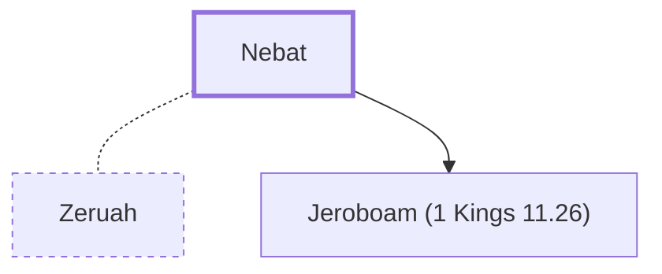

# Nebat

Father of Jeroboam, the first king of Israel.

**Original-language names:** נְבָט (H5028)

## When

- **Placed around:** [[connections/timeline/9th century BC|884 BC]] *(Ussher: the median date of the passages naming them)*

## Family

- **Spouses:** [[connections/people/Zeruah|Zeruah]]
- **Children:** [[connections/people/Jeroboam (1 Kings 11.26)|Jeroboam (1 Kings 11.26)]]
- **Tribe or nation:** Israel

**Family group:** [[connections/genealogy/Family of Nebat|Family of Nebat]], generation 1

## Appears in

[[connections/chapters/11-1-kings/1 Kings 11|1 Kings 11]] · [[connections/chapters/11-1-kings/1 Kings 12|1 Kings 12 (2)]] · [[connections/chapters/11-1-kings/1 Kings 15|1 Kings 15]] · [[connections/chapters/11-1-kings/1 Kings 16|1 Kings 16 (3)]] · [[connections/chapters/11-1-kings/1 Kings 21|1 Kings 21]] · [[connections/chapters/11-1-kings/1 Kings 22|1 Kings 22]] · [[connections/chapters/12-2-kings/2 Kings 3|2 Kings 3]] · [[connections/chapters/12-2-kings/2 Kings 9|2 Kings 9]] · [[connections/chapters/12-2-kings/2 Kings 10|2 Kings 10]] · [[connections/chapters/12-2-kings/2 Kings 13|2 Kings 13 (2)]] · [[connections/chapters/12-2-kings/2 Kings 14|2 Kings 14]] · [[connections/chapters/12-2-kings/2 Kings 15|2 Kings 15 (4)]] · [[connections/chapters/12-2-kings/2 Kings 17|2 Kings 17]] · [[connections/chapters/12-2-kings/2 Kings 23|2 Kings 23]] · [[connections/chapters/14-2-chronicles/2 Chronicles 9|2 Chronicles 9]] · [[connections/chapters/14-2-chronicles/2 Chronicles 10|2 Chronicles 10 (2)]] · [[connections/chapters/14-2-chronicles/2 Chronicles 13|2 Chronicles 13]]

## Appears in the same verse as

[[connections/people/Jeroboam (1 Kings 11.26)|Jeroboam (1 Kings 11.26) (25)]] · [[connections/people/Israel|Israel (14)]] · [[connections/people/Solomon|Solomon (5)]] · [[connections/people/Ahijah (1 Kings 11.29)|Ahijah (1 Kings 11.29) (3)]] · [[connections/people/Baasha|Baasha (3)]] · [[connections/people/Ahijah (1 Kings 15.27)|Ahijah (1 Kings 15.27) (2)]] · [[connections/people/David|David (2)]] · [[connections/places/Bethel (Genesis 12.8)|Bethel (Genesis 12.8) (2)]] · [[connections/places/Egypt|Egypt (2)]] · [[connections/people/Abijah (1 Kings 14.31)|Abijah (1 Kings 14.31)]] · [[connections/people/Ahab (1 Kings 16.28)|Ahab (1 Kings 16.28)]] · [[connections/people/Ethbaal|Ethbaal]] · [[connections/people/Iddo (2 Chronicles 9.29)|Iddo (2 Chronicles 9.29)]] · [[connections/people/Jehu (1 Kings 19.16)|Jehu (1 Kings 19.16)]] · [[connections/people/Jezebel|Jezebel]] · [[connections/people/Judah (Genesis 29.35)|Judah (Genesis 29.35)]] · [[connections/people/Nathan (2 Samuel 7.2)|Nathan (2 Samuel 7.2)]] · [[connections/people/Zeruah|Zeruah]] · [[connections/places/Dan|Dan]] · [[connections/places/Zeredah|Zeredah]]
