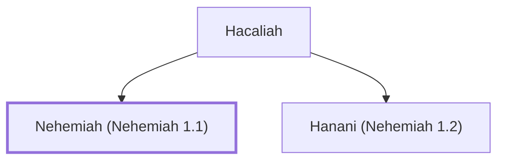

# Nehemiah (Nehemiah 1.1)

Governor of Judah, rebuilt Jerusalem's walls.

**Original-language names:** נְחֶמְיָה (H5166)

## When

- **Placed around:** [[connections/timeline/5th century BC|445 BC]] *(Ussher: the median date of the passages naming them)*

## Family

- **Father:** [[connections/people/Hacaliah|Hacaliah]]
- **Brothers and sisters:** [[connections/people/Hanani (Nehemiah 1.2)|Hanani (Nehemiah 1.2)]]

**Family group:** [[connections/genealogy/Family of Hacaliah|Family of Hacaliah]], generation 2

## Appears in

[[connections/chapters/16-nehemiah/Nehemiah 1|Nehemiah 1]] · [[connections/chapters/16-nehemiah/Nehemiah 8|Nehemiah 8]] · [[connections/chapters/16-nehemiah/Nehemiah 10|Nehemiah 10]] · [[connections/chapters/16-nehemiah/Nehemiah 12|Nehemiah 12 (2)]]

## Appears in the same verse as

[[connections/people/Ezra (Ezra 7.1)|Ezra (Ezra 7.1) (2)]] · [[connections/people/Hacaliah|Hacaliah (2)]] · [[connections/people/Aaron|Aaron]] · [[connections/people/Israel|Israel]] · [[connections/people/Jehozadak|Jehozadak]] · [[connections/people/Joiakim|Joiakim]] · [[connections/people/Joshua (Ezra 2.2)|Joshua (Ezra 2.2)]] · [[connections/people/Zedekiah (Nehemiah 10.2)|Zedekiah (Nehemiah 10.2)]] · [[connections/people/Zerubbabel (1 Chronicles 3.19)|Zerubbabel (1 Chronicles 3.19)]] · [[connections/places/Susa|Susa]]
