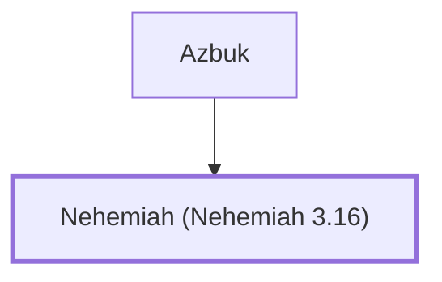

# Nehemiah (Nehemiah 3.16)

Son of Azbuk, repaired a section of Jerusalem's wall.

**Original-language names:** נְחֶמְיָה (H5166)

## When

- **Placed around:** [[connections/timeline/5th century BC|445 BC]] *(Ussher: the median date of the passages naming them)*

## Family

- **Father:** [[connections/people/Azbuk|Azbuk]]

**Family group:** [[connections/genealogy/Family of Azbuk|Family of Azbuk]], generation 2

## Appears in

[[connections/chapters/16-nehemiah/Nehemiah 3|Nehemiah 3]]

## Appears in the same verse as

[[connections/people/Azbuk|Azbuk]] · [[connections/people/David|David]] · [[connections/places/Beth-zur|Beth-zur]]
