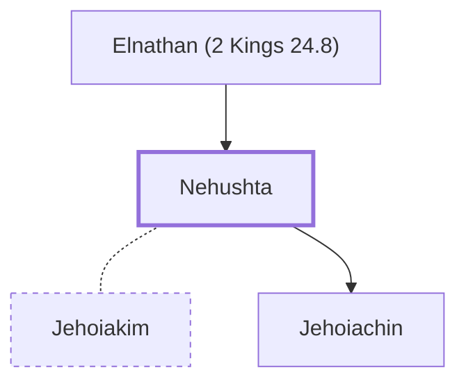

# Nehushta

Mother of King Jehoiachin of Judah.

**Original-language names:** נְחֻשְׁתָּא (H5179)

## When

- **Placed around:** [[connections/timeline/6th century BC|599 BC]] *(Ussher: the median date of the passages naming them)*

## Family

- **Father:** [[connections/people/Elnathan (2 Kings 24.8)|Elnathan (2 Kings 24.8)]]
- **Spouses:** [[connections/people/Jehoiakim|Jehoiakim]]
- **Children:** [[connections/people/Jehoiachin|Jehoiachin]]

**Family group:** [[connections/genealogy/Family of Adam|Family of Adam]], generation 2

## Appears in

[[connections/chapters/12-2-kings/2 Kings 24|2 Kings 24]]

## Appears in the same verse as

[[connections/people/Elnathan (2 Kings 24.8)|Elnathan (2 Kings 24.8)]] · [[connections/people/Jehoiachin|Jehoiachin]] · [[connections/places/Jerusalem|Jerusalem]]
