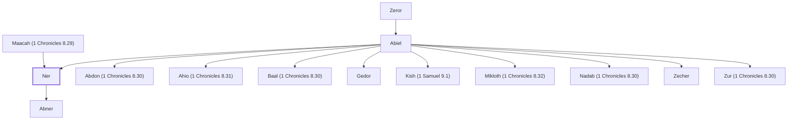

# Ner

Father of Abner, King Saul's commander.

**Original-language names:** נֵר (H5369)

## When

- **Placed around:** [[connections/timeline/11th century BC|1048 BC]] *(Ussher: the median date of the passages naming them)*

## Family

- **Father:** [[connections/people/Abiel|Abiel]]
- **Mother:** [[connections/people/Maacah (1 Chronicles 8.29)|Maacah (1 Chronicles 8.29)]]
- **Brothers and sisters:** [[connections/people/Abdon (1 Chronicles 8.30)|Abdon (1 Chronicles 8.30)]], [[connections/people/Ahio (1 Chronicles 8.31)|Ahio (1 Chronicles 8.31)]], [[connections/people/Baal (1 Chronicles 8.30)|Baal (1 Chronicles 8.30)]], [[connections/people/Gedor|Gedor]], [[connections/people/Kish (1 Samuel 9.1)|Kish (1 Samuel 9.1)]], [[connections/people/Mikloth (1 Chronicles 8.32)|Mikloth (1 Chronicles 8.32)]], [[connections/people/Nadab (1 Chronicles 8.30)|Nadab (1 Chronicles 8.30)]], [[connections/people/Zecher|Zecher]], [[connections/people/Zur (1 Chronicles 8.30)|Zur (1 Chronicles 8.30)]]
- **Children:** [[connections/people/Abner|Abner]]
- **Tribe or nation:** Tribe of Benjamin

**Line of descent** (5 generations, father to son): [[connections/people/Aphiah|Aphiah]] → [[connections/people/Becorath|Becorath]] → [[connections/people/Zeror|Zeror]] → [[connections/people/Abiel|Abiel]] → **Ner**

**Family group:** [[connections/genealogy/Family of Aphiah|Family of Aphiah]], generation 5

## Appears in

[[connections/chapters/09-1-samuel/1 Samuel 14|1 Samuel 14 (2)]] · [[connections/chapters/09-1-samuel/1 Samuel 26|1 Samuel 26 (2)]] · [[connections/chapters/10-2-samuel/2 Samuel 2|2 Samuel 2 (2)]] · [[connections/chapters/10-2-samuel/2 Samuel 3|2 Samuel 3 (4)]] · [[connections/chapters/11-1-kings/1 Kings 2|1 Kings 2 (2)]] · [[connections/chapters/13-1-chronicles/1 Chronicles 9|1 Chronicles 9]] · [[connections/chapters/13-1-chronicles/1 Chronicles 26|1 Chronicles 26]]

## Appears in the same verse as

[[connections/people/Abner|Abner (13)]] · [[connections/people/Saul|Saul (6)]] · [[connections/people/David|David (4)]] · [[connections/people/Israel|Israel (3)]] · [[connections/people/Joab (1 Samuel 26.6)|Joab (1 Samuel 26.6) (3)]] · [[connections/people/Kish (1 Samuel 9.1)|Kish (1 Samuel 9.1) (3)]] · [[connections/people/Amasa (2 Samuel 17.25)|Amasa (2 Samuel 17.25) (2)]] · [[connections/people/Ish-bosheth|Ish-bosheth (2)]] · [[connections/people/Jether (2 Samuel 17.25)|Jether (2 Samuel 17.25) (2)]] · [[connections/people/Zeruiah|Zeruiah (2)]] · [[connections/places/Mahanaim|Mahanaim (2)]] · [[connections/people/Abdon (1 Chronicles 8.30)|Abdon (1 Chronicles 8.30)]] · [[connections/people/Abiel|Abiel]] · [[connections/people/Ahimaaz (1 Samuel 14.50)|Ahimaaz (1 Samuel 14.50)]] · [[connections/people/Ahinoam (1 Samuel 14.50)|Ahinoam (1 Samuel 14.50)]] · [[connections/people/Baal (1 Chronicles 8.30)|Baal (1 Chronicles 8.30)]] · [[connections/people/Judah (Genesis 29.35)|Judah (Genesis 29.35)]] · [[connections/people/Nadab (1 Chronicles 8.30)|Nadab (1 Chronicles 8.30)]] · [[connections/people/Samuel|Samuel]] · [[connections/people/Shelomoth (1 Chronicles 26.25)|Shelomoth (1 Chronicles 26.25)]] · [[connections/people/Zur (1 Chronicles 8.30)|Zur (1 Chronicles 8.30)]] · [[connections/places/Gibeon|Gibeon]]
