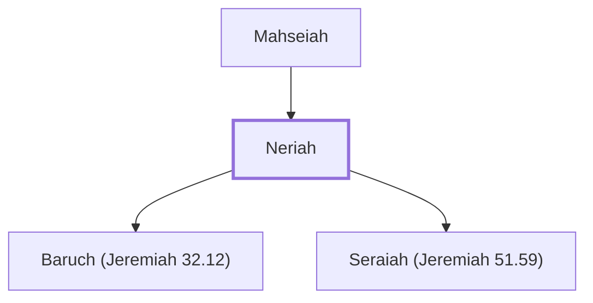

# Neriah

Father of Baruch

**Original-language names:** נֵרִיָהוּ (H5374)

## When

- **Placed around:** [[connections/timeline/6th century BC|589 BC]] *(Ussher: the median date of the passages naming them)*

## Family

- **Father:** [[connections/people/Mahseiah|Mahseiah]]
- **Children:** [[connections/people/Baruch (Jeremiah 32.12)|Baruch (Jeremiah 32.12)]], [[connections/people/Seraiah (Jeremiah 51.59)|Seraiah (Jeremiah 51.59)]]

**Family group:** [[connections/genealogy/Family of Mahseiah|Family of Mahseiah]], generation 2

## Appears in

[[connections/chapters/24-jeremiah/Jeremiah 32|Jeremiah 32 (2)]] · [[connections/chapters/24-jeremiah/Jeremiah 36|Jeremiah 36 (4)]] · [[connections/chapters/24-jeremiah/Jeremiah 43|Jeremiah 43 (2)]] · [[connections/chapters/24-jeremiah/Jeremiah 45|Jeremiah 45]] · [[connections/chapters/24-jeremiah/Jeremiah 51|Jeremiah 51]]

## Appears in the same verse as

[[connections/people/Baruch (Jeremiah 32.12)|Baruch (Jeremiah 32.12) (9)]] · [[connections/people/Jeremiah (2 Chronicles 35.25)|Jeremiah (2 Chronicles 35.25) (6)]] · [[connections/people/Judah (Genesis 29.35)|Judah (Genesis 29.35) (3)]] · [[connections/people/Jehoiakim|Jehoiakim (2)]] · [[connections/people/Mahseiah|Mahseiah (2)]] · [[connections/places/Babylon|Babylon (2)]] · [[connections/people/Ahikam|Ahikam]] · [[connections/people/Cushi (Jeremiah 36.14)|Cushi (Jeremiah 36.14)]] · [[connections/people/Gedaliah (2 Kings 25.22)|Gedaliah (2 Kings 25.22)]] · [[connections/people/Hanamel|Hanamel]] · [[connections/people/Jehudi|Jehudi]] · [[connections/people/Josiah (1 Kings 13.2)|Josiah (1 Kings 13.2)]] · [[connections/people/Nebuzaradan|Nebuzaradan]] · [[connections/people/Nethaniah (Jeremiah 36.14)|Nethaniah (Jeremiah 36.14)]] · [[connections/people/Seraiah (Jeremiah 51.59)|Seraiah (Jeremiah 51.59)]] · [[connections/people/Shaphan (2 Kings 22.3)|Shaphan (2 Kings 22.3)]] · [[connections/people/Shelemiah (Jeremiah 36.14)|Shelemiah (Jeremiah 36.14)]] · [[connections/people/Zedekiah (2 Kings 24.17)|Zedekiah (2 Kings 24.17)]] · [[connections/places/Chaldea|Chaldea]]
