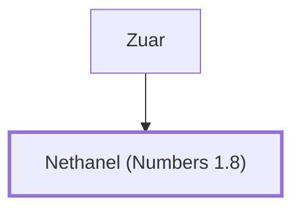

# Nethanel (Numbers 1.8)

Leader of Issachar

**Original-language names:** נְתַנְאֵל (H5417)

## When

- **Placed around:** [[connections/timeline/15th century BC|1490 BC]] *(Ussher: the median date of the passages naming them)*

## Family

- **Father:** [[connections/people/Zuar|Zuar]]
- **Tribe or nation:** Tribe of Issachar

**Family group:** [[connections/genealogy/Family of Zuar|Family of Zuar]], generation 2

## Appears in

[[connections/chapters/04-numbers/Numbers 1|Numbers 1]] · [[connections/chapters/04-numbers/Numbers 2|Numbers 2]] · [[connections/chapters/04-numbers/Numbers 7|Numbers 7 (2)]] · [[connections/chapters/04-numbers/Numbers 10|Numbers 10]]

## Appears in the same verse as

[[connections/people/Zuar|Zuar (5)]] · [[connections/people/Issachar (Genesis 30.18)|Issachar (Genesis 30.18) (4)]]
