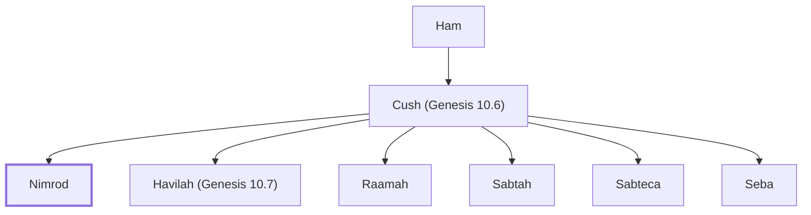

# Nimrod

Mighty hunter, built cities

**Original-language names:** נִמְרֹד (H5248)

## When

- **Placed around:** [[connections/timeline/23rd century BC|2289 BC]] *(Ussher: the median date of the passages naming them)*

## Family

- **Father:** [[connections/people/Cush (Genesis 10.6)|Cush (Genesis 10.6)]]
- **Brothers and sisters:** [[connections/people/Havilah (Genesis 10.7)|Havilah (Genesis 10.7)]], [[connections/people/Raamah|Raamah]], [[connections/people/Sabtah|Sabtah]], [[connections/people/Sabteca|Sabteca]], [[connections/people/Seba|Seba]]
- **Tribe or nation:** Early Patriarch

**Line of descent** (13 generations, father to son): [[connections/people/Adam|Adam]] → [[connections/people/Seth|Seth]] → [[connections/people/Enosh|Enosh]] → [[connections/people/Kenan|Kenan]] → [[connections/people/Mahalalel (Genesis 5.12)|Mahalalel (Genesis 5.12)]] → [[connections/people/Jared|Jared]] → [[connections/people/Enoch (Genesis 5.18)|Enoch (Genesis 5.18)]] → [[connections/people/Methuselah|Methuselah]] → [[connections/people/Lamech (Genesis 5.25)|Lamech (Genesis 5.25)]] → [[connections/people/Noah (Genesis 5.29)|Noah (Genesis 5.29)]] → [[connections/people/Ham|Ham]] → [[connections/people/Cush (Genesis 10.6)|Cush (Genesis 10.6)]] → **Nimrod**

**Family group:** [[connections/genealogy/Family of Adam|Family of Adam]], generation 13

## Events

- [[connections/timeline/19th century BC|1822 BC]] · [[connections/events/Nimrod's kingdom begins|Nimrod's kingdom begins]]

## Appears in

[[connections/chapters/01-genesis/Genesis 10|Genesis 10 (2)]] · [[connections/chapters/13-1-chronicles/1 Chronicles 1|1 Chronicles 1]] · [[connections/chapters/33-micah/Micah 5|Micah 5]]

## Appears in the same verse as

[[connections/people/Cush (Genesis 10.6)|Cush (Genesis 10.6) (2)]] · [[connections/places/Assyria|Assyria]]
