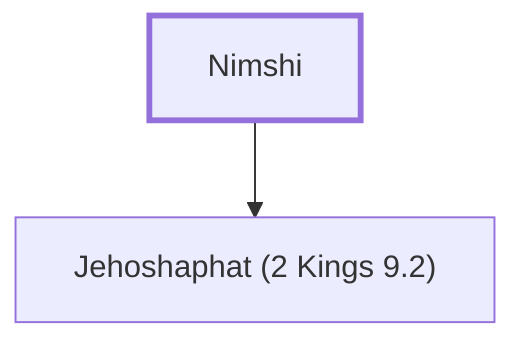

# Nimshi

Grandfather of Jehu

**Original-language names:** נִמְשִׁי (H5250)

## When

- **Placed around:** [[connections/timeline/9th century BC|884 BC]] *(Ussher: the median date of the passages naming them)*

## Family

- **Children:** [[connections/people/Jehoshaphat (2 Kings 9.2)|Jehoshaphat (2 Kings 9.2)]]
- **Tribe or nation:** Israel

**Family group:** [[connections/genealogy/Family of Nimshi|Family of Nimshi]], generation 1

## Appears in

[[connections/chapters/11-1-kings/1 Kings 19|1 Kings 19]] · [[connections/chapters/12-2-kings/2 Kings 9|2 Kings 9 (3)]] · [[connections/chapters/14-2-chronicles/2 Chronicles 22|2 Chronicles 22]]

## Appears in the same verse as

[[connections/people/Jehu (1 Kings 19.16)|Jehu (1 Kings 19.16) (5)]] · [[connections/people/Israel|Israel (2)]] · [[connections/people/Jehoshaphat (2 Kings 9.2)|Jehoshaphat (2 Kings 9.2) (2)]] · [[connections/people/Joram (2 Kings 1.17)|Joram (2 Kings 1.17) (2)]] · [[connections/people/Ahab (1 Kings 16.28)|Ahab (1 Kings 16.28)]] · [[connections/people/Ahaziah (2 Kings 8.24)|Ahaziah (2 Kings 8.24)]] · [[connections/people/Elisha|Elisha]] · [[connections/people/Hazael|Hazael]] · [[connections/people/Shaphat (1 Kings 19.16)|Shaphat (1 Kings 19.16)]] · [[connections/places/Abel-meholah|Abel-meholah]] · [[connections/places/Ramoth|Ramoth]] · [[connections/places/Syria|Syria]]
