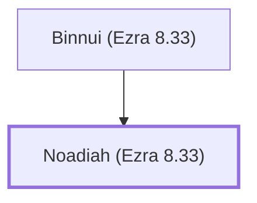

# Noadiah (Ezra 8.33)

Levite in charge of treasuries

**Original-language names:** נוֹעַדְיָה (H5129)

## When

- **Placed around:** [[connections/timeline/5th century BC|457 BC]] *(Ussher: the median date of the passages naming them)*

## Family

- **Father:** [[connections/people/Binnui (Ezra 8.33)|Binnui (Ezra 8.33)]]

**Family group:** [[connections/genealogy/Family of Binnui (Ezra 8.33)|Family of Binnui (Ezra 8.33)]], generation 2

## Appears in

[[connections/chapters/15-ezra/Ezra 8|Ezra 8]]

## Appears in the same verse as

[[connections/people/Binnui (Ezra 8.33)|Binnui (Ezra 8.33)]] · [[connections/people/Eleazar (Ezra 8.33)|Eleazar (Ezra 8.33)]] · [[connections/people/Jeshua (Ezra 8.33)|Jeshua (Ezra 8.33)]] · [[connections/people/Jozabad (Ezra 8.33)|Jozabad (Ezra 8.33)]] · [[connections/people/Meremoth (Ezra 8.33)|Meremoth (Ezra 8.33)]] · [[connections/people/Phinehas (Ezra 8.33)|Phinehas (Ezra 8.33)]] · [[connections/people/Uriah (Ezra 8.33)|Uriah (Ezra 8.33)]]
