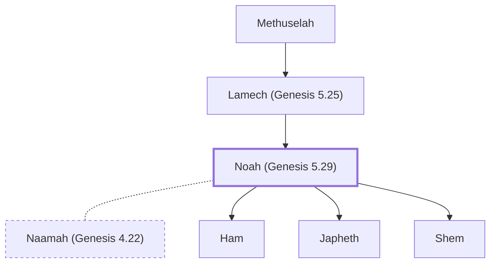

# Noah (Genesis 5.29)

Righteous man, built ark, survived flood

**Original-language names:** נֹחַ (H5146) · Νῶε (G3575)

## When

- **Lived:** [[connections/timeline/30th century BC|2948 BC]] – [[connections/timeline/20th century BC|1998 BC]] *(Jones)*
- **Placed around:** [[connections/timeline/24th century BC|2347 BC]] *(Ussher: the median date of the passages naming them)*

## Family

- **Father:** [[connections/people/Lamech (Genesis 5.25)|Lamech (Genesis 5.25)]]
- **Spouses:** [[connections/people/Naamah (Genesis 4.22)|Naamah (Genesis 4.22) (uncertain)]]
- **Children:** [[connections/people/Ham|Ham]], [[connections/people/Japheth|Japheth]], [[connections/people/Shem|Shem]]
- **Tribe or nation:** Early Patriarch

**Line of descent** (10 generations, father to son): [[connections/people/Adam|Adam]] → [[connections/people/Seth|Seth]] → [[connections/people/Enosh|Enosh]] → [[connections/people/Kenan|Kenan]] → [[connections/people/Mahalalel (Genesis 5.12)|Mahalalel (Genesis 5.12)]] → [[connections/people/Jared|Jared]] → [[connections/people/Enoch (Genesis 5.18)|Enoch (Genesis 5.18)]] → [[connections/people/Methuselah|Methuselah]] → [[connections/people/Lamech (Genesis 5.25)|Lamech (Genesis 5.25)]] → **Noah (Genesis 5.29)**

**Family group:** [[connections/genealogy/Family of Adam|Family of Adam]], generation 10

## Events

- [[connections/timeline/30th century BC|2948 BC]] · [[connections/events/Birth of Noah|Birth of Noah]]
- [[connections/timeline/30th century BC|2948 BC]] · [[connections/events/Lifetime of Noah|Lifetime of Noah]]
- [[connections/timeline/25th century BC|2446 BC]] · [[connections/events/Birth of Shem|Birth of Shem]]
- [[connections/timeline/24th century BC|2400 BC]] · [[connections/events/God instructs Noah to build the ark|God instructs Noah to build the ark]]
- [[connections/timeline/24th century BC|2348 BC]] · [[connections/events/The Great Flood begins|The Great Flood begins]]
- [[connections/timeline/24th century BC|2348 BC]] · [[connections/events/The Great Flood|The Great Flood]]
- [[connections/timeline/24th century BC|2348 BC]] · [[connections/events/Water covers the earth|Water covers the earth]]
- [[connections/timeline/24th century BC|2347 BC]] · [[connections/events/The flood subsides|The flood subsides]]
- [[connections/timeline/24th century BC|2347 BC]] · [[connections/events/Leaving the Ark|Leaving the Ark]]
- [[connections/timeline/24th century BC|2347 BC]] · [[connections/events/God makes a covenant with Noah|God makes a covenant with Noah]]
- [[connections/timeline/24th century BC|2346 BC]] · [[connections/events/Noah gets drunk and Canaan is cursed|Noah gets drunk and Canaan is cursed]]
- [[connections/timeline/20th century BC|1998 BC]] · [[connections/events/Death of Noah|Death of Noah]]

## Appears in

[[connections/chapters/01-genesis/Genesis 5|Genesis 5 (3)]] · [[connections/chapters/01-genesis/Genesis 6|Genesis 6 (5)]] · [[connections/chapters/01-genesis/Genesis 7|Genesis 7 (9)]] · [[connections/chapters/01-genesis/Genesis 8|Genesis 8 (7)]] · [[connections/chapters/01-genesis/Genesis 9|Genesis 9 (9)]] · [[connections/chapters/01-genesis/Genesis 10|Genesis 10 (2)]] · [[connections/chapters/13-1-chronicles/1 Chronicles 1|1 Chronicles 1]] · [[connections/chapters/23-isaiah/Isaiah 54|Isaiah 54]] · [[connections/chapters/26-ezekiel/Ezekiel 14|Ezekiel 14 (2)]] · [[connections/chapters/40-matthew/Matthew 24|Matthew 24 (2)]] · [[connections/chapters/42-luke/Luke 3|Luke 3]] · [[connections/chapters/42-luke/Luke 17|Luke 17 (2)]] · [[connections/chapters/58-hebrews/Hebrews 11|Hebrews 11]] · [[connections/chapters/60-1-peter/1 Peter 3|1 Peter 3]] · [[connections/chapters/61-2-peter/2 Peter 2|2 Peter 2]]

## Appears in the same verse as

[[connections/people/Shem|Shem (7)]] · [[connections/people/Ham|Ham (6)]] · [[connections/people/Japheth|Japheth (6)]] · [[connections/people/Daniel (Ezekiel 14.14)|Daniel (Ezekiel 14.14) (2)]] · [[connections/people/Job|Job (2)]] · [[connections/people/Lamech (Genesis 5.25)|Lamech (Genesis 5.25) (2)]] · [[connections/people/Arpachshad|Arpachshad]] · [[connections/people/Cainan|Cainan]] · [[connections/people/Canaan|Canaan]]
