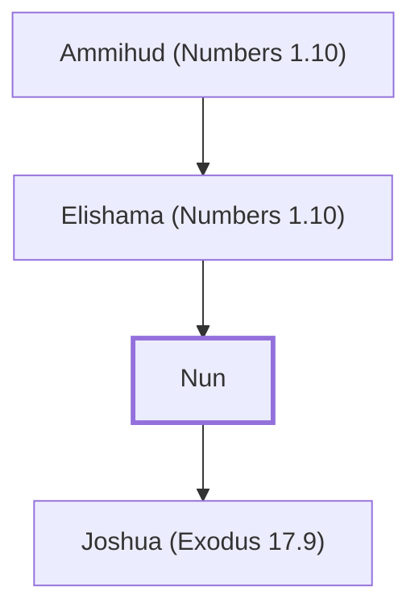

# Nun

Father of Joshua

**Original-language names:** נוּן (H5126)

## When

- **Placed around:** [[connections/timeline/15th century BC|1451 BC]] *(Ussher: the median date of the passages naming them)*

## Family

- **Father:** [[connections/people/Elishama (Numbers 1.10)|Elishama (Numbers 1.10)]]
- **Children:** [[connections/people/Joshua (Exodus 17.9)|Joshua (Exodus 17.9)]]
- **Tribe or nation:** Tribe of Ephraim

**Line of descent** (33 generations, father to son): [[connections/people/Adam|Adam]] → [[connections/people/Seth|Seth]] → [[connections/people/Enosh|Enosh]] → [[connections/people/Kenan|Kenan]] → [[connections/people/Mahalalel (Genesis 5.12)|Mahalalel (Genesis 5.12)]] → [[connections/people/Jared|Jared]] → [[connections/people/Enoch (Genesis 5.18)|Enoch (Genesis 5.18)]] → [[connections/people/Methuselah|Methuselah]] → [[connections/people/Lamech (Genesis 5.25)|Lamech (Genesis 5.25)]] → [[connections/people/Noah (Genesis 5.29)|Noah (Genesis 5.29)]] → [[connections/people/Shem|Shem]] → [[connections/people/Arpachshad|Arpachshad]] → [[connections/people/Cainan|Cainan]] → [[connections/people/Shelah (Genesis 10.24)|Shelah (Genesis 10.24)]] → [[connections/people/Eber (Genesis 10.21)|Eber (Genesis 10.21)]] → [[connections/people/Peleg|Peleg]] → [[connections/people/Reu|Reu]] → [[connections/people/Serug|Serug]] → [[connections/people/Nahor (Genesis 11.22)|Nahor (Genesis 11.22)]] → [[connections/people/Terah|Terah]] → [[connections/people/Abraham|Abraham]] → [[connections/people/Isaac|Isaac]] → [[connections/people/Israel|Israel]] → [[connections/people/Joseph (Genesis 30.24)|Joseph (Genesis 30.24)]] → [[connections/people/Ephraim|Ephraim]] → [[connections/people/Beriah (1 Chronicles 7.23)|Beriah (1 Chronicles 7.23)]] → [[connections/people/Resheph|Resheph]] → [[connections/people/Telah|Telah]] → [[connections/people/Tahan (1 Chronicles 7.25)|Tahan (1 Chronicles 7.25)]] → [[connections/people/Ladan|Ladan]] → [[connections/people/Ammihud (Numbers 1.10)|Ammihud (Numbers 1.10)]] → [[connections/people/Elishama (Numbers 1.10)|Elishama (Numbers 1.10)]] → **Nun**

**Family group:** [[connections/genealogy/Family of Adam|Family of Adam]], generation 33

## Appears in

[[connections/chapters/02-exodus/Exodus 33|Exodus 33]] · [[connections/chapters/04-numbers/Numbers 11|Numbers 11]] · [[connections/chapters/04-numbers/Numbers 13|Numbers 13 (2)]] · [[connections/chapters/04-numbers/Numbers 14|Numbers 14 (3)]] · [[connections/chapters/04-numbers/Numbers 26|Numbers 26]] · [[connections/chapters/04-numbers/Numbers 27|Numbers 27]] · [[connections/chapters/04-numbers/Numbers 32|Numbers 32 (2)]] · [[connections/chapters/04-numbers/Numbers 34|Numbers 34]] · [[connections/chapters/05-deuteronomy/Deuteronomy 1|Deuteronomy 1]] · [[connections/chapters/05-deuteronomy/Deuteronomy 31|Deuteronomy 31]] · [[connections/chapters/05-deuteronomy/Deuteronomy 32|Deuteronomy 32]] · [[connections/chapters/05-deuteronomy/Deuteronomy 34|Deuteronomy 34]] · [[connections/chapters/06-joshua/Joshua 1|Joshua 1]] · [[connections/chapters/06-joshua/Joshua 2|Joshua 2 (2)]] · [[connections/chapters/06-joshua/Joshua 6|Joshua 6]] · [[connections/chapters/06-joshua/Joshua 14|Joshua 14]] · [[connections/chapters/06-joshua/Joshua 17|Joshua 17]] · [[connections/chapters/06-joshua/Joshua 19|Joshua 19 (2)]] · [[connections/chapters/06-joshua/Joshua 21|Joshua 21]] · [[connections/chapters/06-joshua/Joshua 24|Joshua 24]] · [[connections/chapters/07-judges/Judges 2|Judges 2]] · [[connections/chapters/11-1-kings/1 Kings 16|1 Kings 16]] · [[connections/chapters/13-1-chronicles/1 Chronicles 7|1 Chronicles 7]] · [[connections/chapters/16-nehemiah/Nehemiah 8|Nehemiah 8]]

## Appears in the same verse as

[[connections/people/Joshua (Exodus 17.9)|Joshua (Exodus 17.9) (30)]] · [[connections/people/Israel|Israel (9)]] · [[connections/people/Moses|Moses (9)]] · [[connections/people/Eleazar (Exodus 6.23)|Eleazar (Exodus 6.23) (6)]] · [[connections/people/Caleb (Numbers 13.6)|Caleb (Numbers 13.6) (5)]] · [[connections/people/Jephunneh (Numbers 13.6)|Jephunneh (Numbers 13.6) (5)]] · [[connections/places/Jericho|Jericho (2)]] · [[connections/people/Abiram (1 Kings 16.34)|Abiram (1 Kings 16.34)]] · [[connections/people/Ephraim|Ephraim]] · [[connections/people/Hiel|Hiel]] · [[connections/people/Rahab|Rahab]] · [[connections/people/Segub (1 Kings 16.34)|Segub (1 Kings 16.34)]] · [[connections/places/Bethel (Genesis 12.8)|Bethel (Genesis 12.8)]] · [[connections/places/Canaan|Canaan]] · [[connections/places/Shiloh|Shiloh]] · [[connections/places/Shittim|Shittim]]
