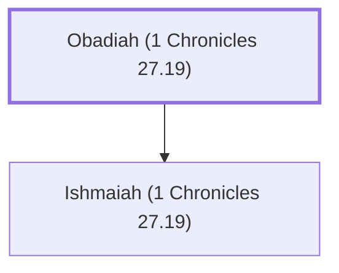

# Obadiah (1 Chronicles 27.19)

Ruler over Zebulun in David's time

**Original-language names:** עֹבַדְיָ֫הוּ (H5662)

## When

- **Placed around:** [[connections/timeline/11th century BC|1015 BC]] *(Ussher: the median date of the passages naming them)*

## Family

- **Children:** [[connections/people/Ishmaiah (1 Chronicles 27.19)|Ishmaiah (1 Chronicles 27.19)]]

**Family group:** [[connections/genealogy/Family of Obadiah (1 Chronicles 27.19)|Family of Obadiah (1 Chronicles 27.19)]], generation 1

## Appears in

[[connections/chapters/13-1-chronicles/1 Chronicles 27|1 Chronicles 27]]

## Appears in the same verse as

[[connections/people/Azriel (1 Chronicles 27.19)|Azriel (1 Chronicles 27.19)]] · [[connections/people/Ishmaiah (1 Chronicles 27.19)|Ishmaiah (1 Chronicles 27.19)]] · [[connections/people/Jerimoth (1 Chronicles 27.19)|Jerimoth (1 Chronicles 27.19)]] · [[connections/people/Naphtali|Naphtali]] · [[connections/people/Zebulun|Zebulun]]
