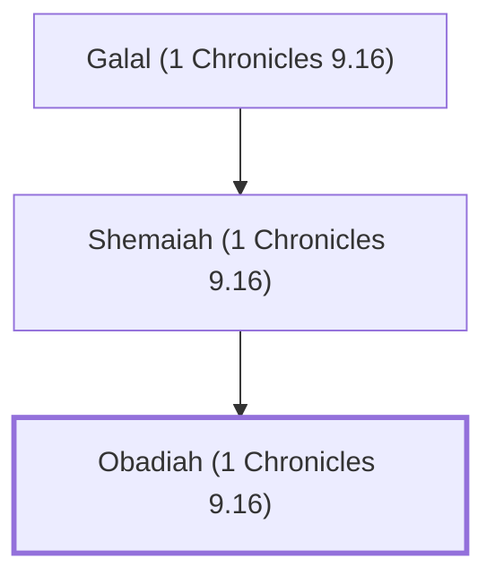

# Obadiah (1 Chronicles 9.16)

Gatekeeper, descendant of Jeduthun

**Also called:** Abda

**Original-language names:** עֹבַדְיָ֫הוּ (H5662) · עַבְדָּא (H5653)

## When

- **Placed around:** [[connections/timeline/5th century BC|445 BC]] *(Ussher: the median date of the passages naming them)*

## Family

- **Father:** [[connections/people/Shemaiah (1 Chronicles 9.16)|Shemaiah (1 Chronicles 9.16)]]
- **Tribe or nation:** Tribe of Levi

**Line of descent** (4 generations, father to son): [[connections/people/Jeduthun (1 Chronicles 9.16)|Jeduthun (1 Chronicles 9.16)]] → [[connections/people/Galal (1 Chronicles 9.16)|Galal (1 Chronicles 9.16)]] → [[connections/people/Shemaiah (1 Chronicles 9.16)|Shemaiah (1 Chronicles 9.16)]] → **Obadiah (1 Chronicles 9.16)**

**Family group:** [[connections/genealogy/Family of Jeduthun (1 Chronicles 9.16)|Family of Jeduthun (1 Chronicles 9.16)]], generation 4

## Appears in

[[connections/chapters/13-1-chronicles/1 Chronicles 9|1 Chronicles 9]] · [[connections/chapters/16-nehemiah/Nehemiah 11|Nehemiah 11]] · [[connections/chapters/16-nehemiah/Nehemiah 12|Nehemiah 12]]

## Appears in the same verse as

[[connections/people/Bakbukiah|Bakbukiah (2)]] · [[connections/people/Galal (1 Chronicles 9.16)|Galal (1 Chronicles 9.16) (2)]] · [[connections/people/Jeduthun (1 Chronicles 9.16)|Jeduthun (1 Chronicles 9.16) (2)]] · [[connections/people/Mattaniah (1 Chronicles 9.15)|Mattaniah (1 Chronicles 9.15) (2)]] · [[connections/people/Shemaiah (1 Chronicles 9.16)|Shemaiah (1 Chronicles 9.16) (2)]] · [[connections/people/Akkub (1 Chronicles 9.17)|Akkub (1 Chronicles 9.17)]] · [[connections/people/Asa (1 Chronicles 9.16)|Asa (1 Chronicles 9.16)]] · [[connections/people/Asaph (1 Chronicles 9.15)|Asaph (1 Chronicles 9.15)]] · [[connections/people/Berechiah (1 Chronicles 9.16)|Berechiah (1 Chronicles 9.16)]] · [[connections/people/Elkanah (1 Chronicles 9.16)|Elkanah (1 Chronicles 9.16)]] · [[connections/people/Meshullam (Nehemiah 12.25)|Meshullam (Nehemiah 12.25)]] · [[connections/people/Mica (1 Chronicles 9.15)|Mica (1 Chronicles 9.15)]] · [[connections/people/Talmon|Talmon]] · [[connections/people/Zichri (1 Chronicles 9.15)|Zichri (1 Chronicles 9.15)]]
