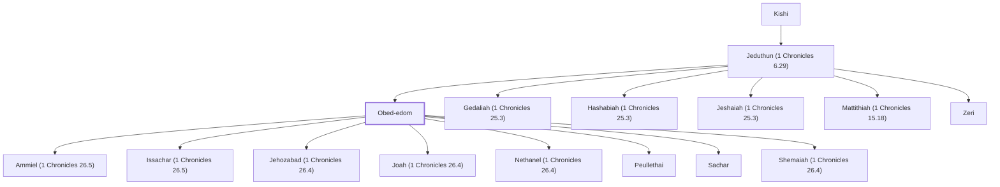

# Obed-edom

Gittite who housed the Ark

**Also called:** Shimei

**Original-language names:** עֹבֵד אֱדוֹם (H5654) · שִׁמְעִי (H8096)

## When

- **Placed around:** [[connections/timeline/11th century BC|1042 BC]] *(Ussher: the median date of the passages naming them)*

## Family

- **Father:** [[connections/people/Jeduthun (1 Chronicles 6.29)|Jeduthun (1 Chronicles 6.29)]]
- **Brothers and sisters:** [[connections/people/Gedaliah (1 Chronicles 25.3)|Gedaliah (1 Chronicles 25.3)]], [[connections/people/Hashabiah (1 Chronicles 25.3)|Hashabiah (1 Chronicles 25.3)]], [[connections/people/Jeshaiah (1 Chronicles 25.3)|Jeshaiah (1 Chronicles 25.3)]], [[connections/people/Mattithiah (1 Chronicles 15.18)|Mattithiah (1 Chronicles 15.18)]], [[connections/people/Zeri|Zeri]]
- **Children:** [[connections/people/Ammiel (1 Chronicles 26.5)|Ammiel (1 Chronicles 26.5)]], [[connections/people/Issachar (1 Chronicles 26.5)|Issachar (1 Chronicles 26.5)]], [[connections/people/Jehozabad (1 Chronicles 26.4)|Jehozabad (1 Chronicles 26.4)]], [[connections/people/Joah (1 Chronicles 26.4)|Joah (1 Chronicles 26.4)]], [[connections/people/Nethanel (1 Chronicles 26.4)|Nethanel (1 Chronicles 26.4)]], [[connections/people/Peullethai|Peullethai]], [[connections/people/Sachar|Sachar]], [[connections/people/Shemaiah (1 Chronicles 26.4)|Shemaiah (1 Chronicles 26.4)]]
- **Tribe or nation:** Tribe of Levi

**Line of descent** (38 generations, father to son): [[connections/people/Adam|Adam]] → [[connections/people/Seth|Seth]] → [[connections/people/Enosh|Enosh]] → [[connections/people/Kenan|Kenan]] → [[connections/people/Mahalalel (Genesis 5.12)|Mahalalel (Genesis 5.12)]] → [[connections/people/Jared|Jared]] → [[connections/people/Enoch (Genesis 5.18)|Enoch (Genesis 5.18)]] → [[connections/people/Methuselah|Methuselah]] → [[connections/people/Lamech (Genesis 5.25)|Lamech (Genesis 5.25)]] → [[connections/people/Noah (Genesis 5.29)|Noah (Genesis 5.29)]] → [[connections/people/Shem|Shem]] → [[connections/people/Arpachshad|Arpachshad]] → [[connections/people/Cainan|Cainan]] → [[connections/people/Shelah (Genesis 10.24)|Shelah (Genesis 10.24)]] → [[connections/people/Eber (Genesis 10.21)|Eber (Genesis 10.21)]] → [[connections/people/Peleg|Peleg]] → [[connections/people/Reu|Reu]] → [[connections/people/Serug|Serug]] → [[connections/people/Nahor (Genesis 11.22)|Nahor (Genesis 11.22)]] → [[connections/people/Terah|Terah]] → [[connections/people/Abraham|Abraham]] → [[connections/people/Isaac|Isaac]] → [[connections/people/Israel|Israel]] → [[connections/people/Levi (Genesis 29.34)|Levi (Genesis 29.34)]] → [[connections/people/Merari|Merari]] → [[connections/people/Mushi|Mushi]] → [[connections/people/Mahli (1 Chronicles 6.32)|Mahli (1 Chronicles 6.32)]] → [[connections/people/Shemer (1 Chronicles 6.31)|Shemer (1 Chronicles 6.31)]] → [[connections/people/Bani (1 Chronicles 6.31)|Bani (1 Chronicles 6.31)]] → [[connections/people/Amzi (1 Chronicles 6.31)|Amzi (1 Chronicles 6.31)]] → [[connections/people/Hilkiah (1 Chronicles 6.30)|Hilkiah (1 Chronicles 6.30)]] → [[connections/people/Amaziah (1 Chronicles 6.30)|Amaziah (1 Chronicles 6.30)]] → [[connections/people/Hashabiah (1 Chronicles 6.30)|Hashabiah (1 Chronicles 6.30)]] → [[connections/people/Malluch (1 Chronicles 6.29)|Malluch (1 Chronicles 6.29)]] → [[connections/people/Abdi (1 Chronicles 6.29)|Abdi (1 Chronicles 6.29)]] → [[connections/people/Kishi|Kishi]] → [[connections/people/Jeduthun (1 Chronicles 6.29)|Jeduthun (1 Chronicles 6.29)]] → **Obed-edom**

**Family group:** [[connections/genealogy/Family of Adam|Family of Adam]], generation 38

## Appears in

[[connections/chapters/10-2-samuel/2 Samuel 6|2 Samuel 6 (3)]] · [[connections/chapters/13-1-chronicles/1 Chronicles 13|1 Chronicles 13 (2)]] · [[connections/chapters/13-1-chronicles/1 Chronicles 15|1 Chronicles 15 (4)]] · [[connections/chapters/13-1-chronicles/1 Chronicles 16|1 Chronicles 16 (2)]] · [[connections/chapters/13-1-chronicles/1 Chronicles 25|1 Chronicles 25]] · [[connections/chapters/13-1-chronicles/1 Chronicles 26|1 Chronicles 26 (3)]] · [[connections/chapters/14-2-chronicles/2 Chronicles 25|2 Chronicles 25]]

## Appears in the same verse as

[[connections/people/David|David (4)]] · [[connections/people/Jeiel (1 Chronicles 15.18)|Jeiel (1 Chronicles 15.18) (4)]] · [[connections/people/Benaiah (1 Chronicles 15.18)|Benaiah (1 Chronicles 15.18) (3)]] · [[connections/people/Mattithiah (1 Chronicles 15.18)|Mattithiah (1 Chronicles 15.18) (3)]] · [[connections/people/Zechariah (1 Chronicles 9.21)|Zechariah (1 Chronicles 9.21) (3)]] · [[connections/people/Eliab (1 Chronicles 15.18)|Eliab (1 Chronicles 15.18) (2)]] · [[connections/people/Eliphelehu|Eliphelehu (2)]] · [[connections/people/Jaaziel|Jaaziel (2)]] · [[connections/people/Jehiel (1 Chronicles 15.18)|Jehiel (1 Chronicles 15.18) (2)]] · [[connections/people/Mikneiah|Mikneiah (2)]] · [[connections/people/Shemiramoth (1 Chronicles 15.18)|Shemiramoth (1 Chronicles 15.18) (2)]] · [[connections/people/Amasai (1 Chronicles 15.24)|Amasai (1 Chronicles 15.24)]] · [[connections/people/Asaph (1 Chronicles 6.24)|Asaph (1 Chronicles 6.24)]] · [[connections/people/Azaziah (1 Chronicles 15.21)|Azaziah (1 Chronicles 15.21)]] · [[connections/people/Ben|Ben]] · [[connections/people/Eliezer (1 Chronicles 15.24)|Eliezer (1 Chronicles 15.24)]] · [[connections/people/Hosah|Hosah]] · [[connections/people/Israel|Israel]] · [[connections/people/Jeduthun (1 Chronicles 6.29)|Jeduthun (1 Chronicles 6.29)]] · [[connections/people/Jehozabad (1 Chronicles 26.4)|Jehozabad (1 Chronicles 26.4)]] · [[connections/people/Joah (1 Chronicles 26.4)|Joah (1 Chronicles 26.4)]] · [[connections/people/Joshaphat (1 Chronicles 15.24)|Joshaphat (1 Chronicles 15.24)]] · [[connections/people/Maaseiah (1 Chronicles 15.18)|Maaseiah (1 Chronicles 15.18)]] · [[connections/people/Nethanel (1 Chronicles 15.24)|Nethanel (1 Chronicles 15.24)]] · [[connections/people/Nethanel (1 Chronicles 26.4)|Nethanel (1 Chronicles 26.4)]] · [[connections/people/Sachar|Sachar]] · [[connections/people/Shebaniah (1 Chronicles 15.24)|Shebaniah (1 Chronicles 15.24)]] · [[connections/people/Shemaiah (1 Chronicles 26.4)|Shemaiah (1 Chronicles 26.4)]] · [[connections/people/Unni (1 Chronicles 15.18)|Unni (1 Chronicles 15.18)]] · [[connections/places/Samaria|Samaria]]
