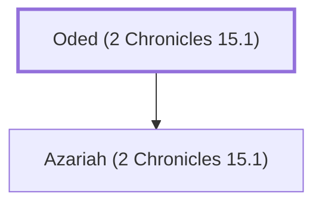

# Oded (2 Chronicles 15.1)

Prophet, father of Azariah

**Original-language names:** עֹדֵד (H5752)

## Family

- **Children:** [[connections/people/Azariah (2 Chronicles 15.1)|Azariah (2 Chronicles 15.1)]]

**Family group:** [[connections/genealogy/Family of Oded (2 Chronicles 15.1)|Family of Oded (2 Chronicles 15.1)]], generation 1

## Appears in

[[connections/chapters/14-2-chronicles/2 Chronicles 15|2 Chronicles 15 (2)]]

## Appears in the same verse as

[[connections/people/Asa (1 Kings 15.8)|Asa (1 Kings 15.8)]] · [[connections/people/Azariah (2 Chronicles 15.1)|Azariah (2 Chronicles 15.1)]] · [[connections/people/Benjamin (Genesis 35.18)|Benjamin (Genesis 35.18)]] · [[connections/people/Ephraim|Ephraim]] · [[connections/people/Judah (Genesis 29.35)|Judah (Genesis 29.35)]]
