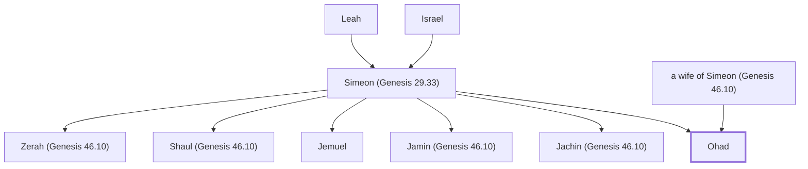

# Ohad

Son of Simeon

**Original-language names:** אֹ֫הַד (H0161)

## When

- **Placed around:** [[connections/timeline/15th century BC|1491 BC]] *(Ussher: the median date of the passages naming them)*

## Family

- **Father:** [[connections/people/Simeon (Genesis 29.33)|Simeon (Genesis 29.33)]]
- **Mother:** [[connections/people/a wife of Simeon (Genesis 46.10)|a wife of Simeon (Genesis 46.10)]]
- **Brothers and sisters:** [[connections/people/Jachin (Genesis 46.10)|Jachin (Genesis 46.10)]], [[connections/people/Jamin (Genesis 46.10)|Jamin (Genesis 46.10)]], [[connections/people/Jemuel|Jemuel]], [[connections/people/Shaul (Genesis 46.10)|Shaul (Genesis 46.10)]], [[connections/people/Zerah (Genesis 46.10)|Zerah (Genesis 46.10)]]
- **Tribe or nation:** Tribe of Simeon

**Line of descent** (25 generations, father to son): [[connections/people/Adam|Adam]] → [[connections/people/Seth|Seth]] → [[connections/people/Enosh|Enosh]] → [[connections/people/Kenan|Kenan]] → [[connections/people/Mahalalel (Genesis 5.12)|Mahalalel (Genesis 5.12)]] → [[connections/people/Jared|Jared]] → [[connections/people/Enoch (Genesis 5.18)|Enoch (Genesis 5.18)]] → [[connections/people/Methuselah|Methuselah]] → [[connections/people/Lamech (Genesis 5.25)|Lamech (Genesis 5.25)]] → [[connections/people/Noah (Genesis 5.29)|Noah (Genesis 5.29)]] → [[connections/people/Shem|Shem]] → [[connections/people/Arpachshad|Arpachshad]] → [[connections/people/Cainan|Cainan]] → [[connections/people/Shelah (Genesis 10.24)|Shelah (Genesis 10.24)]] → [[connections/people/Eber (Genesis 10.21)|Eber (Genesis 10.21)]] → [[connections/people/Peleg|Peleg]] → [[connections/people/Reu|Reu]] → [[connections/people/Serug|Serug]] → [[connections/people/Nahor (Genesis 11.22)|Nahor (Genesis 11.22)]] → [[connections/people/Terah|Terah]] → [[connections/people/Abraham|Abraham]] → [[connections/people/Isaac|Isaac]] → [[connections/people/Israel|Israel]] → [[connections/people/Simeon (Genesis 29.33)|Simeon (Genesis 29.33)]] → **Ohad**

**Family group:** [[connections/genealogy/Family of Adam|Family of Adam]], generation 25

## Appears in

[[connections/chapters/01-genesis/Genesis 46|Genesis 46]] · [[connections/chapters/02-exodus/Exodus 6|Exodus 6]]

## Appears in the same verse as

[[connections/people/Jachin (Genesis 46.10)|Jachin (Genesis 46.10) (2)]] · [[connections/people/Jamin (Genesis 46.10)|Jamin (Genesis 46.10) (2)]] · [[connections/people/Jemuel|Jemuel (2)]] · [[connections/people/Shaul (Genesis 46.10)|Shaul (Genesis 46.10) (2)]] · [[connections/people/Simeon (Genesis 29.33)|Simeon (Genesis 29.33) (2)]] · [[connections/people/Zerah (Genesis 46.10)|Zerah (Genesis 46.10) (2)]]
