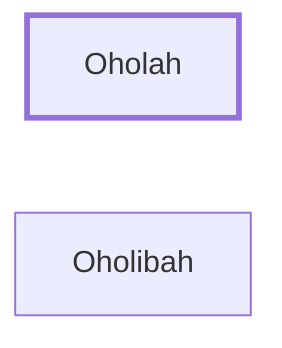

# Oholah

Symbolic name for Samaria

**Original-language names:** אׇהֳלָה (H0170)

## When

- **Placed around:** [[connections/timeline/6th century BC|593 BC]] *(Ussher: the median date of the passages naming them)*

## Family

- **Brothers and sisters:** [[connections/people/Oholibah|Oholibah]]

## Appears in

[[connections/chapters/26-ezekiel/Ezekiel 23|Ezekiel 23 (4)]]

## Appears in the same verse as

[[connections/people/Oholibah|Oholibah (3)]] · [[connections/places/Assyria|Assyria]] · [[connections/places/Jerusalem|Jerusalem]] · [[connections/places/Samaria|Samaria]]
