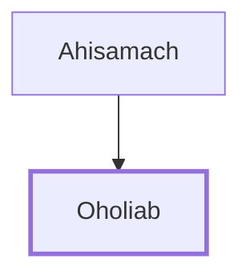

# Oholiab

Skilled craftsman for the tabernacle

**Original-language names:** אׇהֳלִיאָב (H0171)

## When

- **Placed around:** [[connections/timeline/15th century BC|1491 BC]] *(Ussher: the median date of the passages naming them)*

## Family

- **Father:** [[connections/people/Ahisamach|Ahisamach]]

**Family group:** [[connections/genealogy/Family of Ahisamach|Family of Ahisamach]], generation 2

## Appears in

[[connections/chapters/02-exodus/Exodus 31|Exodus 31]] · [[connections/chapters/02-exodus/Exodus 35|Exodus 35]] · [[connections/chapters/02-exodus/Exodus 36|Exodus 36 (2)]] · [[connections/chapters/02-exodus/Exodus 38|Exodus 38]]

## Appears in the same verse as

[[connections/people/Ahisamach|Ahisamach (3)]] · [[connections/places/Dan|Dan (3)]] · [[connections/people/Bezalel (Exodus 31.2)|Bezalel (Exodus 31.2) (2)]] · [[connections/people/Moses|Moses]]
