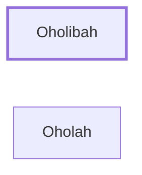

# Oholibah

Symbolic name for Jerusalem

**Original-language names:** אׇהֳלִיבָה (H0172)

## When

- **Placed around:** [[connections/timeline/6th century BC|593 BC]] *(Ussher: the median date of the passages naming them)*

## Family

- **Brothers and sisters:** [[connections/people/Oholah|Oholah]]

## Appears in

[[connections/chapters/26-ezekiel/Ezekiel 23|Ezekiel 23 (5)]]

## Appears in the same verse as

[[connections/people/Oholah|Oholah (3)]] · [[connections/places/Jerusalem|Jerusalem]] · [[connections/places/Samaria|Samaria]]
