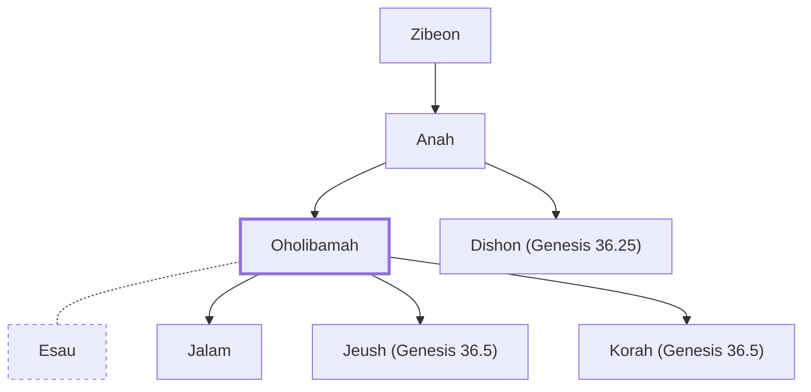

# Oholibamah

Wife of Esau

**Original-language names:** אׇהֳלִיבָמָה (H0173)

## When

- **Placed around:** [[connections/timeline/18th century BC|1756 BC]] *(Ussher: the median date of the passages naming them)*

## Family

- **Father:** [[connections/people/Anah|Anah]]
- **Brothers and sisters:** [[connections/people/Dishon (Genesis 36.25)|Dishon (Genesis 36.25)]]
- **Spouses:** [[connections/people/Esau|Esau]]
- **Children:** [[connections/people/Jalam|Jalam]], [[connections/people/Jeush (Genesis 36.5)|Jeush (Genesis 36.5)]], [[connections/people/Korah (Genesis 36.5)|Korah (Genesis 36.5)]]
- **Tribe or nation:** Edom

**Line of descent** (4 generations, father to son): [[connections/people/Seir|Seir]] → [[connections/people/Zibeon|Zibeon]] → [[connections/people/Anah|Anah]] → **Oholibamah**

**Family group:** [[connections/genealogy/Family of Adam|Family of Adam]], generation 4

## Appears in

[[connections/chapters/01-genesis/Genesis 36|Genesis 36 (6)]] · [[connections/chapters/13-1-chronicles/1 Chronicles 1|1 Chronicles 1]]

## Appears in the same verse as

[[connections/people/Anah|Anah (4)]] · [[connections/people/Esau|Esau (4)]] · [[connections/people/Jalam|Jalam (3)]] · [[connections/people/Jeush (Genesis 36.5)|Jeush (Genesis 36.5) (3)]] · [[connections/people/Korah (Genesis 36.5)|Korah (Genesis 36.5) (3)]] · [[connections/people/Elah (Genesis 36.41)|Elah (Genesis 36.41) (2)]] · [[connections/people/Pinon|Pinon (2)]] · [[connections/people/Zibeon|Zibeon (2)]] · [[connections/places/Canaan|Canaan (2)]] · [[connections/people/Adah (Genesis 26.34)|Adah (Genesis 26.34)]] · [[connections/people/Dishon (Genesis 36.25)|Dishon (Genesis 36.25)]] · [[connections/people/Elon (Genesis 26.34)|Elon (Genesis 26.34)]]
