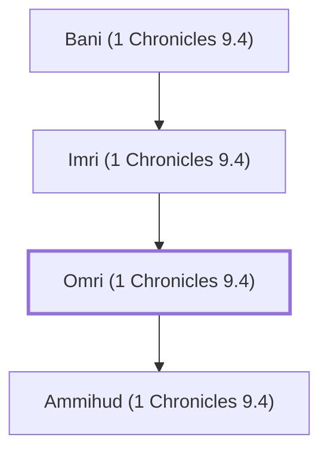

# Omri (1 Chronicles 9.4)

Descendant of Judah in Jerusalem

**Original-language names:** עׇמְרִי (H6018)

## When

- **Placed around:** [[connections/timeline/6th century BC|536 BC]] *(Ussher: the median date of the passages naming them)*

## Family

- **Father:** [[connections/people/Imri (1 Chronicles 9.4)|Imri (1 Chronicles 9.4)]]
- **Children:** [[connections/people/Ammihud (1 Chronicles 9.4)|Ammihud (1 Chronicles 9.4)]]
- **Tribe or nation:** Tribe of Judah

**Line of descent** (3 generations, father to son): [[connections/people/Bani (1 Chronicles 9.4)|Bani (1 Chronicles 9.4)]] → [[connections/people/Imri (1 Chronicles 9.4)|Imri (1 Chronicles 9.4)]] → **Omri (1 Chronicles 9.4)**

**Family group:** [[connections/genealogy/Family of Bani (1 Chronicles 9.4)|Family of Bani (1 Chronicles 9.4)]], generation 3

## Appears in

[[connections/chapters/13-1-chronicles/1 Chronicles 9|1 Chronicles 9]]

## Appears in the same verse as

[[connections/people/Ammihud (1 Chronicles 9.4)|Ammihud (1 Chronicles 9.4)]] · [[connections/people/Bani (1 Chronicles 9.4)|Bani (1 Chronicles 9.4)]] · [[connections/people/Imri (1 Chronicles 9.4)|Imri (1 Chronicles 9.4)]] · [[connections/people/Judah (Genesis 29.35)|Judah (Genesis 29.35)]] · [[connections/people/Perez|Perez]] · [[connections/people/Uthai (1 Chronicles 9.4)|Uthai (1 Chronicles 9.4)]]
