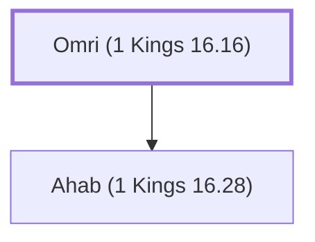

# Omri (1 Kings 16.16)

King of Israel; father of Ahab

**Original-language names:** עׇמְרִי (H6018)

## When

- **Placed around:** [[connections/timeline/10th century BC|925 BC]] *(Ussher: the median date of the passages naming them)*

## Family

- **Children:** [[connections/people/Ahab (1 Kings 16.28)|Ahab (1 Kings 16.28)]]
- **Tribe or nation:** Israel

**Family group:** [[connections/genealogy/Family of Adam|Family of Adam]], generation 1

## Events

- [[connections/timeline/10th century BC|929 BC]] · [[connections/events/Reign of Omri|Reign of Omri]]
- [[connections/timeline/10th century BC|918 BC]] · [[connections/events/Death of Omri|Death of Omri]]

## Appears in

[[connections/chapters/11-1-kings/1 Kings 16|1 Kings 16 (10)]] · [[connections/chapters/12-2-kings/2 Kings 8|2 Kings 8]] · [[connections/chapters/14-2-chronicles/2 Chronicles 22|2 Chronicles 22]] · [[connections/chapters/33-micah/Micah 6|Micah 6]]

## Appears in the same verse as

[[connections/people/Israel|Israel (7)]] · [[connections/people/Ahab (1 Kings 16.28)|Ahab (1 Kings 16.28) (4)]] · [[connections/people/Ahaziah (2 Kings 8.24)|Ahaziah (2 Kings 8.24) (2)]] · [[connections/people/Asa (1 Kings 15.8)|Asa (1 Kings 15.8) (2)]] · [[connections/people/Athaliah (2 Kings 8.26)|Athaliah (2 Kings 8.26) (2)]] · [[connections/people/Ginath|Ginath (2)]] · [[connections/people/Judah (Genesis 29.35)|Judah (Genesis 29.35) (2)]] · [[connections/people/Tibni|Tibni (2)]] · [[connections/places/Jerusalem|Jerusalem (2)]] · [[connections/places/Samaria|Samaria (2)]] · [[connections/places/Tirzah|Tirzah (2)]] · [[connections/people/Zimri (1 Kings 16.9)|Zimri (1 Kings 16.9)]] · [[connections/places/Gibbethon|Gibbethon]]
