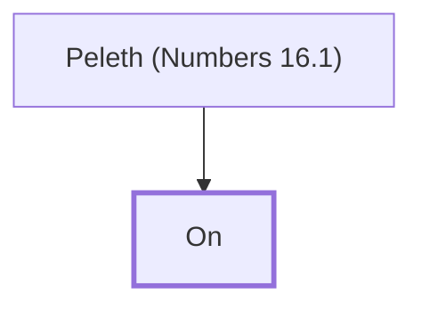

# On

Reubenite involved in Korah's rebellion

**Original-language names:** אוֹן (H0203)

## When

- **Placed around:** [[connections/timeline/15th century BC|1471 BC]] *(Ussher: the median date of the passages naming them)*

## Family

- **Father:** [[connections/people/Peleth (Numbers 16.1)|Peleth (Numbers 16.1)]]

**Family group:** [[connections/genealogy/Family of Peleth (Numbers 16.1)|Family of Peleth (Numbers 16.1)]], generation 2

## Appears in

[[connections/chapters/04-numbers/Numbers 16|Numbers 16]]

## Appears in the same verse as

[[connections/people/Abiram (Numbers 16.1)|Abiram (Numbers 16.1)]] · [[connections/people/Dathan|Dathan]] · [[connections/people/Eliab (Numbers 16.1)|Eliab (Numbers 16.1)]] · [[connections/people/Izhar (Exodus 6.18)|Izhar (Exodus 6.18)]] · [[connections/people/Kohath|Kohath]] · [[connections/people/Korah (Exodus 6.21)|Korah (Exodus 6.21)]] · [[connections/people/Levi (Genesis 29.34)|Levi (Genesis 29.34)]] · [[connections/people/Peleth (Numbers 16.1)|Peleth (Numbers 16.1)]] · [[connections/people/Reuben|Reuben]]
