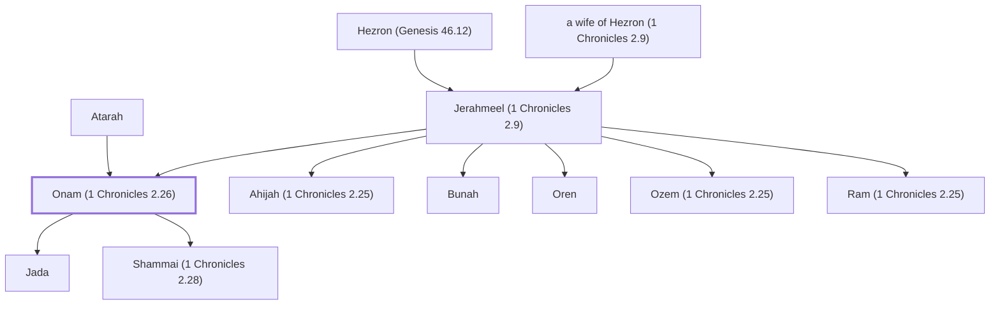

# Onam (1 Chronicles 2.26)

Descendant of Judah, son of Jerahmeel

**Original-language names:** אוֹנָם (H0208)

## When

- **Placed around:** [[connections/timeline/15th century BC|1470 BC]] *(Ussher: the median date of the passages naming them)*

## Family

- **Father:** [[connections/people/Jerahmeel (1 Chronicles 2.9)|Jerahmeel (1 Chronicles 2.9)]]
- **Mother:** [[connections/people/Atarah|Atarah]]
- **Brothers and sisters:** [[connections/people/Ahijah (1 Chronicles 2.25)|Ahijah (1 Chronicles 2.25)]], [[connections/people/Bunah|Bunah]], [[connections/people/Oren|Oren]], [[connections/people/Ozem (1 Chronicles 2.25)|Ozem (1 Chronicles 2.25)]], [[connections/people/Ram (1 Chronicles 2.25)|Ram (1 Chronicles 2.25)]]
- **Children:** [[connections/people/Jada|Jada]], [[connections/people/Shammai (1 Chronicles 2.28)|Shammai (1 Chronicles 2.28)]]
- **Tribe or nation:** Tribe of Judah

**Line of descent** (28 generations, father to son): [[connections/people/Adam|Adam]] → [[connections/people/Seth|Seth]] → [[connections/people/Enosh|Enosh]] → [[connections/people/Kenan|Kenan]] → [[connections/people/Mahalalel (Genesis 5.12)|Mahalalel (Genesis 5.12)]] → [[connections/people/Jared|Jared]] → [[connections/people/Enoch (Genesis 5.18)|Enoch (Genesis 5.18)]] → [[connections/people/Methuselah|Methuselah]] → [[connections/people/Lamech (Genesis 5.25)|Lamech (Genesis 5.25)]] → [[connections/people/Noah (Genesis 5.29)|Noah (Genesis 5.29)]] → [[connections/people/Shem|Shem]] → [[connections/people/Arpachshad|Arpachshad]] → [[connections/people/Cainan|Cainan]] → [[connections/people/Shelah (Genesis 10.24)|Shelah (Genesis 10.24)]] → [[connections/people/Eber (Genesis 10.21)|Eber (Genesis 10.21)]] → [[connections/people/Peleg|Peleg]] → [[connections/people/Reu|Reu]] → [[connections/people/Serug|Serug]] → [[connections/people/Nahor (Genesis 11.22)|Nahor (Genesis 11.22)]] → [[connections/people/Terah|Terah]] → [[connections/people/Abraham|Abraham]] → [[connections/people/Isaac|Isaac]] → [[connections/people/Israel|Israel]] → [[connections/people/Judah (Genesis 29.35)|Judah (Genesis 29.35)]] → [[connections/people/Perez|Perez]] → [[connections/people/Hezron (Genesis 46.12)|Hezron (Genesis 46.12)]] → [[connections/people/Jerahmeel (1 Chronicles 2.9)|Jerahmeel (1 Chronicles 2.9)]] → **Onam (1 Chronicles 2.26)**

**Family group:** [[connections/genealogy/Family of Adam|Family of Adam]], generation 28

## Appears in

[[connections/chapters/13-1-chronicles/1 Chronicles 2|1 Chronicles 2 (2)]]

## Appears in the same verse as

[[connections/people/Abishur|Abishur]] · [[connections/people/Atarah|Atarah]] · [[connections/people/Jada|Jada]] · [[connections/people/Jerahmeel (1 Chronicles 2.9)|Jerahmeel (1 Chronicles 2.9)]] · [[connections/people/Nadab (1 Chronicles 2.28)|Nadab (1 Chronicles 2.28)]] · [[connections/people/Shammai (1 Chronicles 2.28)|Shammai (1 Chronicles 2.28)]]
