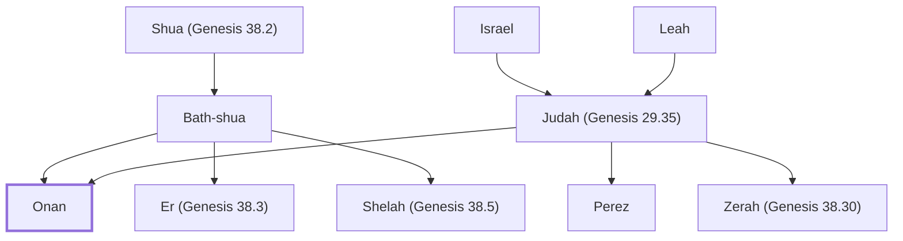

# Onan

Son of Judah

**Original-language names:** אוֹנָן (H0209)

## When

- **Placed around:** [[connections/timeline/18th century BC|1722 BC]] *(Ussher: the median date of the passages naming them)*

## Family

- **Father:** [[connections/people/Judah (Genesis 29.35)|Judah (Genesis 29.35)]]
- **Mother:** [[connections/people/Bath-shua|Bath-shua]]
- **Brothers and sisters:** [[connections/people/Er (Genesis 38.3)|Er (Genesis 38.3)]], [[connections/people/Perez|Perez]], [[connections/people/Shelah (Genesis 38.5)|Shelah (Genesis 38.5)]], [[connections/people/Zerah (Genesis 38.30)|Zerah (Genesis 38.30)]]
- **Tribe or nation:** Tribe of Judah

**Line of descent** (25 generations, father to son): [[connections/people/Adam|Adam]] → [[connections/people/Seth|Seth]] → [[connections/people/Enosh|Enosh]] → [[connections/people/Kenan|Kenan]] → [[connections/people/Mahalalel (Genesis 5.12)|Mahalalel (Genesis 5.12)]] → [[connections/people/Jared|Jared]] → [[connections/people/Enoch (Genesis 5.18)|Enoch (Genesis 5.18)]] → [[connections/people/Methuselah|Methuselah]] → [[connections/people/Lamech (Genesis 5.25)|Lamech (Genesis 5.25)]] → [[connections/people/Noah (Genesis 5.29)|Noah (Genesis 5.29)]] → [[connections/people/Shem|Shem]] → [[connections/people/Arpachshad|Arpachshad]] → [[connections/people/Cainan|Cainan]] → [[connections/people/Shelah (Genesis 10.24)|Shelah (Genesis 10.24)]] → [[connections/people/Eber (Genesis 10.21)|Eber (Genesis 10.21)]] → [[connections/people/Peleg|Peleg]] → [[connections/people/Reu|Reu]] → [[connections/people/Serug|Serug]] → [[connections/people/Nahor (Genesis 11.22)|Nahor (Genesis 11.22)]] → [[connections/people/Terah|Terah]] → [[connections/people/Abraham|Abraham]] → [[connections/people/Isaac|Isaac]] → [[connections/people/Israel|Israel]] → [[connections/people/Judah (Genesis 29.35)|Judah (Genesis 29.35)]] → **Onan**

**Family group:** [[connections/genealogy/Family of Adam|Family of Adam]], generation 25

## Appears in

[[connections/chapters/01-genesis/Genesis 38|Genesis 38 (3)]] · [[connections/chapters/01-genesis/Genesis 46|Genesis 46]] · [[connections/chapters/04-numbers/Numbers 26|Numbers 26]] · [[connections/chapters/13-1-chronicles/1 Chronicles 2|1 Chronicles 2]]

## Appears in the same verse as

[[connections/people/Judah (Genesis 29.35)|Judah (Genesis 29.35) (4)]] · [[connections/people/Er (Genesis 38.3)|Er (Genesis 38.3) (3)]] · [[connections/people/Shelah (Genesis 38.5)|Shelah (Genesis 38.5) (2)]] · [[connections/places/Canaan|Canaan (2)]] · [[connections/people/Bath-shua|Bath-shua]] · [[connections/people/Hamul|Hamul]] · [[connections/people/Hezron (Genesis 46.12)|Hezron (Genesis 46.12)]] · [[connections/people/Perez|Perez]] · [[connections/people/Shua (Genesis 38.2)|Shua (Genesis 38.2)]] · [[connections/people/Zerah (Genesis 38.30)|Zerah (Genesis 38.30)]]
