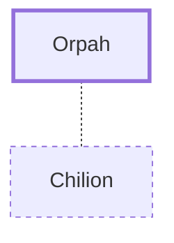

# Orpah

Naomi's daughter-in-law, stayed in Moab

**Original-language names:** עׇרְפָּה (H6204)

## When

- **Placed around:** [[connections/timeline/14th century BC|1308 BC]] *(Ussher: the median date of the passages naming them)*

## Family

- **Spouses:** [[connections/people/Chilion|Chilion]]
- **Tribe or nation:** Moab

## Appears in

[[connections/chapters/08-ruth/Ruth 1|Ruth 1 (2)]]

## Appears in the same verse as

[[connections/people/Ruth|Ruth (2)]] · [[connections/places/Moab|Moab]]
