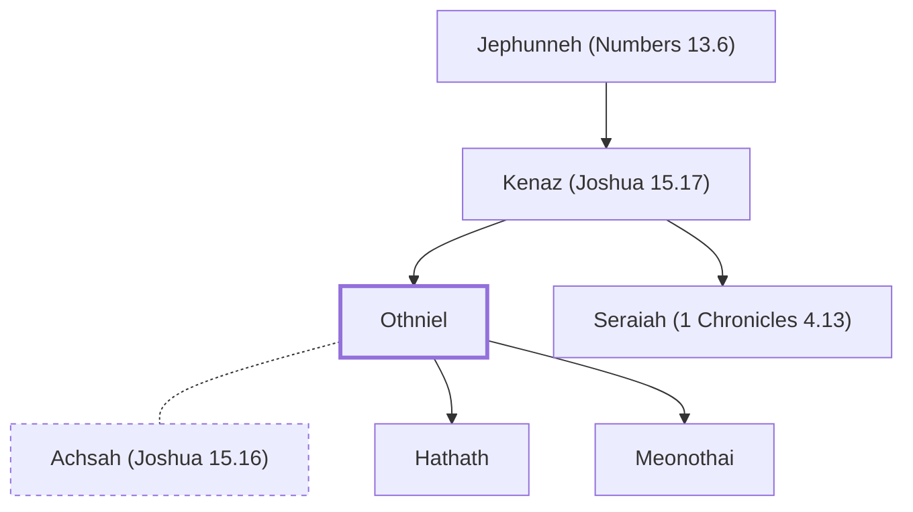

# Othniel

First judge of Israel, Caleb's nephew

**Original-language names:** עׇתְנִיאֵל (H6274)

## When

- **Placed around:** [[connections/timeline/15th century BC|1405 BC]] *(Ussher: the median date of the passages naming them)*

## Family

- **Father:** [[connections/people/Kenaz (Joshua 15.17)|Kenaz (Joshua 15.17)]]
- **Brothers and sisters:** [[connections/people/Seraiah (1 Chronicles 4.13)|Seraiah (1 Chronicles 4.13)]]
- **Spouses:** [[connections/people/Achsah (Joshua 15.16)|Achsah (Joshua 15.16)]]
- **Children:** [[connections/people/Hathath|Hathath]], [[connections/people/Meonothai|Meonothai (uncertain)]]

**Line of descent** (3 generations, father to son): [[connections/people/Jephunneh (Numbers 13.6)|Jephunneh (Numbers 13.6)]] → [[connections/people/Kenaz (Joshua 15.17)|Kenaz (Joshua 15.17)]] → **Othniel**

**Family group:** [[connections/genealogy/Family of Jephunneh (Numbers 13.6)|Family of Jephunneh (Numbers 13.6)]], generation 3

## Events

- [[connections/timeline/15th century BC|1410 BC]] · [[connections/events/Deliverance by Othniel|Deliverance by Othniel]]

## Appears in

[[connections/chapters/06-joshua/Joshua 15|Joshua 15]] · [[connections/chapters/07-judges/Judges 1|Judges 1]] · [[connections/chapters/07-judges/Judges 3|Judges 3 (2)]] · [[connections/chapters/13-1-chronicles/1 Chronicles 4|1 Chronicles 4]] · [[connections/chapters/13-1-chronicles/1 Chronicles 27|1 Chronicles 27]]

## Appears in the same verse as

[[connections/people/Kenaz (Joshua 15.17)|Kenaz (Joshua 15.17) (5)]] · [[connections/people/Caleb (Numbers 13.6)|Caleb (Numbers 13.6) (3)]] · [[connections/people/Achsah (Joshua 15.16)|Achsah (Joshua 15.16) (2)]] · [[connections/people/Hathath|Hathath]] · [[connections/people/Heleb|Heleb]] · [[connections/people/Israel|Israel]] · [[connections/people/Seraiah (1 Chronicles 4.13)|Seraiah (1 Chronicles 4.13)]]
